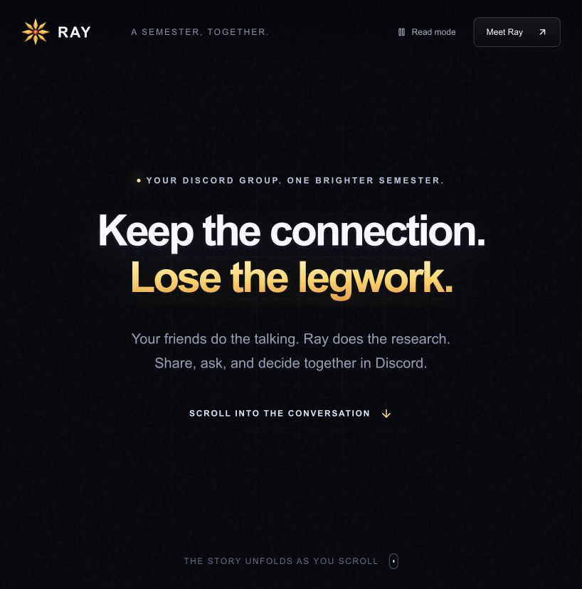
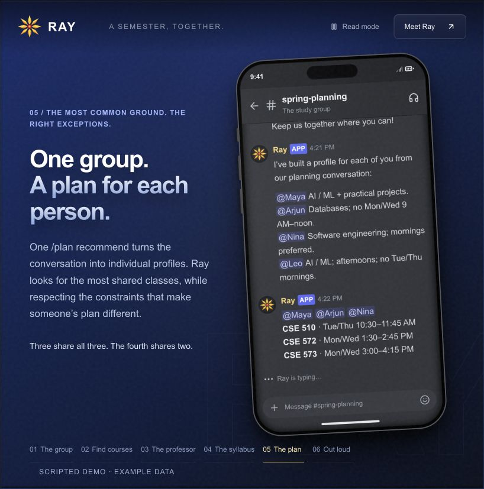
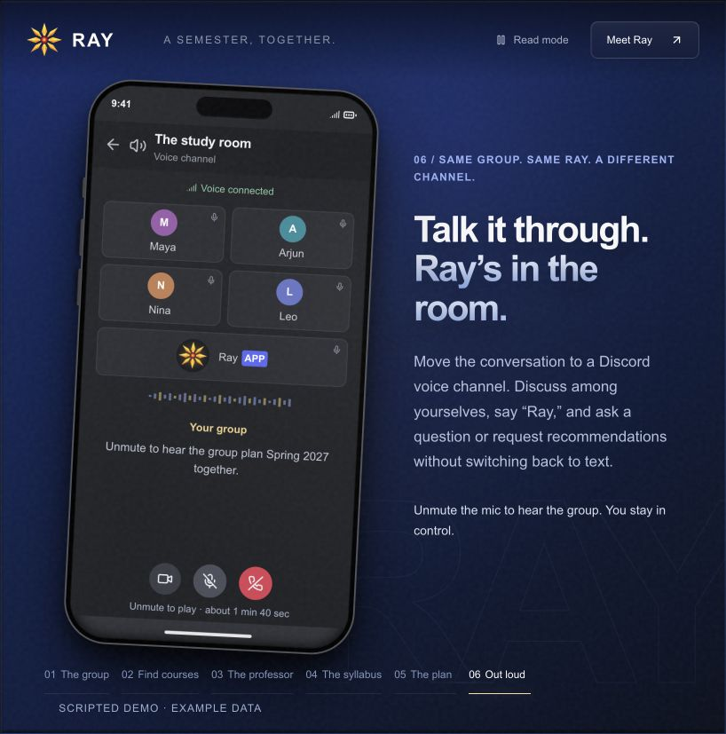
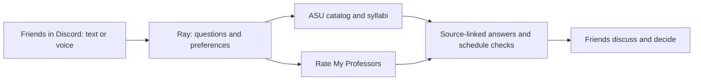

<p align="center"></p>
<h1 align="center">Ray</h1>
<p align="center"><strong>Keep the connection. Lose the legwork.</strong></p>
<p align="center">Your friends do the talking. Ray does the course research.</p>
<p align="center"><a href="https://ray-common-class.glossyalder32.chatgpt.site/">Explore the public website →</a></p>



## Why Ray?

Planning a semester together means comparing schedules, searching courses, reading syllabi, and checking professors. Ray brings that research into your Discord conversation so friends can discuss and decide together.

- **Keep the human connection.** Students share their own interests and make the final decisions.
- **Research in one place.** Ask about courses, syllabi, and professor reviews inside Discord.
- **Respect individual needs.** Treat explicit availability and work hours as hard constraints.
- **Find common ground.** Maximize shared classes, with individual alternatives when needed.
- **Show the evidence.** Link sources and flag missing or uncertain information.
- **Talk it through.** Opt into voice to ask questions and request group recommendations aloud.

## See the story

The [public website](https://ray-common-class.glossyalder32.chatgpt.site/) walks through six scenes:

1. Four friends share interests and availability.
2. Ray finds courses that match their questions.
3. Students ask about professor reviews.
4. Ray checks a syllabus for topics and grading.
5. The group gets shared classes and individual alternatives.
6. Friends discuss their plans with Ray in a voice channel.

| Plan together | Talk with Ray |
| --- | --- |
|  |  |

The website uses scripted example data and a prerecorded, five-voice conversation. Unmute the illustrated mic to play it. Live research and recommendations run through the separate Discord bot.

## Try Ray in Discord

- `/ask question:What do we learn in CSE 573?` — research a course, syllabus, or professor.
- `/plan start semester:Spring 2027` — start a workspace; each student clicks **Join planning**.
- Chat naturally about interests, schedules, and preferences.
- `/plan recommend` — get individual recommendations and a shared group summary.
- `/voice join consent:true` — opt into audio processing in the configured voice channel.

See the [bot guide](bot/README.md) for configuration, permissions, voice controls, and profile resets.

## Run locally

**Requirements:** Node 24.8 (`.nvmrc`), Python 3.11+, Docker with Compose, and your own provider/Discord credentials.

```bash
npm ci
python3 -m venv .venv
.venv/bin/python -m pip install -r requirements.txt
cp .env.example .env  # First setup only; preserve an existing .env
```

Fill in `.env` using the [setup guide](bot/README.md#setup-and-start), then:

```bash
npm run register:commands
npm run dev
```

This starts local Postgres, migrations, both research APIs, and the bot worker. Voice needs additional ElevenLabs/channel configuration and is off by default.

To run only the website:

```bash
npm ci --prefix landing
npm run dev --prefix landing
```

## How it works



| Part | Purpose |
| --- | --- |
| [Discord bot](bot/) | TypeScript, LangGraph, student profiles, research, planning, voice |
| [ASU API](class_search_api/) | Sections, schedules, prerequisites, syllabus retrieval |
| [Professor API](rmp_api/) | Professor search, ratings, review text |
| [Website](landing/) | React, Vite, GSAP scroll story, playable voice scene |
| Postgres | Planning state, profiles, checkpoints, delivery records |

## Checks and limits

```bash
npm run build
npm test
npm run test:voice
.venv/bin/python -m pytest -q
npm run build --prefix landing
```

- Group and voice-planning checks need an isolated test database; see the [bot guide](bot/README.md).
- Voice is implemented; a complete live, multi-person rehearsal remains pending. See [voice validation](docs/voice-ray-milestones.md).
- ASU and RMP are unofficial integrations. Seats change; historical syllabi may differ from current offerings.
- Ray proposes options. It does not enroll students or verify degree eligibility.

## More detail

- [Bot setup and commands](bot/README.md)
- [API setup, endpoints, and response contracts](docs/api-guide.md)
- [Architecture](docs/workflow-architecture.md)
- [Website setup and demo notes](landing/README.md)
- [Milestone checklist](docs/discord-bot-milestones.md)
- [API verification](verification.md) · [Source notes](SOURCE_NOTES.md)
