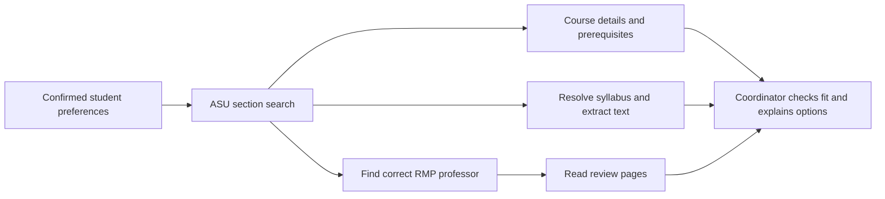

# SameClass · Track 3 APIs

**Find classes friends can take together, without losing what each person needs.**

This repository contains the course-research backend for SameClass: two independently runnable Python APIs, ready for the group-chat coordinator to call. It carries forward the ASU and Rate My Professors integrations from Class_Helper, without the old UI, LLM agents, Reddit pipeline, local caches, or credentials.

| Folder | What it provides | Default port |
| --- | --- | --- |
| [class_search_api](class_search_api/) | Live ASU sections, all original search filters, subjects, complete course details, prerequisites, current/historical syllabus resolution, document download and text extraction | 8000 |
| [rmp_api](rmp_api/) | School search, professor search/details, ratings, paginated review text, bounded bulk professor/review retrieval | 8001 |

## Bot implementation plan

The APIs, **Ray**'s local foundation, and the Milestone 1 Discord preference workflow are implemented. The user confirmed the private-server smoke test passed, and session state survived a worker restart. Course research remains disconnected from Ray until Milestone 2. See the [bot setup guide](bot/README.md) for one-command local startup and validation. Start with the [canonical milestone checklist](docs/discord-bot-milestones.md), consult the [workflow and architecture](docs/workflow-architecture.md) while implementing, and use the [mock chat scenarios](docs/mock-chat-scenarios.md) for testing. The [integration validation](docs/integration-validation.md) records API capabilities and limitations the bot must handle.

## Start both services

Python **3.11+**. Run these commands from the repository root:

```bash
python3 -m venv .venv
source .venv/bin/activate
python -m pip install -r requirements.txt
```

In two terminals with the environment activated:

```bash
python -m uvicorn class_search_api.server:app --host 127.0.0.1 --port 8000
```

```bash
python -m uvicorn rmp_api.server:app --host 127.0.0.1 --port 8001
```

Explore [ASU API docs](http://127.0.0.1:8000/docs) and [RMP API docs](http://127.0.0.1:8001/docs). Each service also exposes `/health`, `/redoc`, and `/openapi.json`. The checked-in `openapi.json` files document the same routes and core response models.

Neither service needs an LLM key, student password, database, or the original Class_Helper checkout. Imports and health checks do not contact external sources. Each folder has its own requirements and can be copied alongside an empty `__init__.py`-aware Python project without the other folder.

## Connect the teammate's coordinator



1. Call `/api/search` with `term`, course/interest filters, and a bounded `max_pages`.
2. Use each result's `course_id` for `/api/courses` or `/api/course_description`. Use `meeting_intervals` and `timezone` for deterministic schedule checks; an `unknown` interval cannot establish a conflict-free schedule.
3. In parallel, call `/api/syllabus/lookup` with the course and professor name, and search `/api/professors` for that instructor at the correct RMP school. ASU Tempe's RMP school ID is `15723` (also accepts `U2Nob29sLTE1NzIz`). Confirm identity using name, school, and department; name search may return multiple people.
4. Fetch `/api/professors/{id}/reviews/all`. Keep the full comments for interpretation and respect the returned coverage. Review `class` is the original RMP course label, not a standardized course ID.
5. Keep source timestamps, profile/class URLs, syllabus term, warnings, and retrieval status with the evidence. A missing source should leave a field unknown while the rest of the recommendation can proceed.

The APIs retrieve evidence. The coordinator owns preference extraction, eligibility reasoning, workload interpretation, recommendations, and group-chat state.

## Reliability and response contracts

- Stable JSON envelopes and typed core responses; raw ASU search/course records remain available for additional source fields.
- Short connection/read timeouts, at most two retries for transient HTTP failures, request-scoped Sessions, and bounded pagination. Time budgets stop between operations; an in-flight request may finish after the budget.
- Page cursors, deduplication, explicit `complete`/`stop_reason`, and source timestamps. `complete` describes retrieval from the supplied cursor, not whether a human read every result.
- HTTP `422` for invalid input; `404` for absent professor/course/syllabus; `502` for source/GraphQL failures; `503` for rate limiting or a syllabus still preparing; `504` for timeouts. Errors never become successful empty lists.
- Syllabus discovery returns a normal JSON result with `status: ok | not_found | incomplete | unavailable`, allowing optional syllabus evidence to fail independently.
- PDF, DOCX, HTML and text extraction; PDF page numbers; truncation markers; scanned PDFs explicitly report `ocr_required`. No OCR or automatic assignment/grading inference is claimed.

These are unofficial public-source integrations. Source schemas and availability can change, and seat counts are observations rather than enrollment guarantees. Historical syllabi describe earlier offerings. The services do not enroll students or verify degree eligibility.

For cross-origin browser calls, set `CORS_ORIGINS` to a comma-separated list such as `http://localhost:3000`. Server-to-server calls need no CORS. These are backend services with no application authentication; use your application's authenticated server as the caller when deploying.

## Verification

```bash
python -m pip install -r requirements-dev.txt
ruff check .
pytest -q
# Optional: real upstream checks, run only when network access is wanted
python scripts/smoke_test.py
```

`requirements-lock.txt` records the exact environment used for local verification; install with `pip install -r requirements-dev.txt -c requirements-lock.txt` to reproduce it. CI tests Python 3.11–3.13 against those constraints. Offline tests do not contact ASU or RMP. The live smoke script tests the actual ASGI HTTP routes and keeps its output to source metadata and counts, without saving signed download URLs or review comments.

Read [verification.md](verification.md) for the tested live scenario and [SOURCE_NOTES.md](SOURCE_NOTES.md) for the extraction map. Teams can build against [class_search_api/example_response.json](class_search_api/example_response.json) and [rmp_api/example_response.json](rmp_api/example_response.json); both are explicitly synthetic contract examples.
