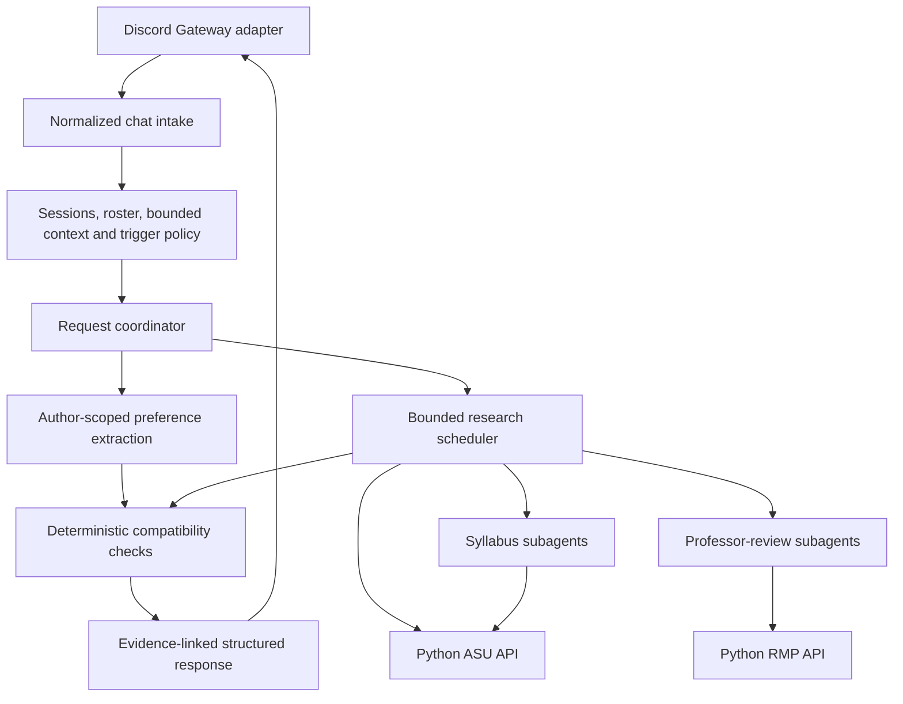

# Ray Discord bot: implementation milestones

Plan accepted in principle by the team on October 24, 2026 (America/Phoenix). Milestones 0–2 are complete. Milestone 3 implementation and live research checks are in place; its new Discord answers and command/reply visibility are awaiting the user’s smoke check. Complete one milestone, report its evidence and limitations, and wait for the next milestone before continuing. This file is the canonical build checklist; it supersedes the earlier open interview questions where decisions are recorded below.

## 1. Agreed scope

- Build a Discord bot first, using a private text channel in a Discord server. Discord supplies the chat UI.
- Initial demo audience: ASU graduate CS students choosing electives. Use the ASU catalog integration; do not claim support for other universities or a complete degree audit.
- Students explicitly join planning through a button and receive a model-processing notice. Session membership is distinct from server/channel membership.
- Use OpenRouter for the model calls powering a TypeScript coordinator and scoped research subagents, with Zod validation, LangGraph.js workflow orchestration and Postgres persistence (local initially, Supabase when deployed). Start with `deepseek/deepseek-v4.1-flash-1017` served by Relace, subject to the focused live capability/quality checks below. Preserve the committed Python catalog/RMP services behind typed HTTP clients.
- Return ranked section shortlists, shared options, and individual alternatives. A shortlist is not a verified complete semester schedule; report any unchecked course-count, total-credit, prerequisite, or requirement-fulfillment dimension.
- Support mention-triggered group planning, participant-directed clarification, direct replies to outstanding questions, and individual course questions that do not alter profiles.
- Return useful results for participants with enough information. A silent registered participant stays unknown and is asked once; their silence does not block everyone else.
- Develop locally from Milestone 0: run the bot and Python APIs on the developer machine, with a local Postgres database. Retain Render for the later persistent bot/private backend and Supabase Postgres for deployed state. Keep application logic independent of hostnames, credentials and deployment environment so moving later requires configuration, migrations and packaging rather than a rewrite.
- Keep the planning core independent of Discord. An optional owned UI will initially have its own rooms; live Discord/web synchronization and account linking are deferred.
- Use focused checks during early milestones, then expand the mock regression suite in Milestone 4 to exercise complex multi-step workflows and combined failures. Do not pursue exhaustive combinations, coverage targets, load benchmarks, or repeated unrelated integration checks.

## 2. Documentation baseline

Current Discord documentation was consulted through the configured **Context7 MCP**, using `/discordjs/guide` and `/discord/discord-api-docs`. Context7 was reached through its configured MCP HTTP endpoint because its tools were not exposed directly in this chat. Library IDs were resolved before documentation queries. See [reference notes](discord-reference-notes.md) for sources and findings.

Important implementation constraints:

1. Use a persistent Gateway connection, with discord.js handling connection lifecycle. A request-only function is insufficient for listening to ordinary channel messages.
2. Request `Guilds`, `GuildMessages`, and `MessageContent`; enable Message Content Intent in the Developer Portal. An explicit join roster does not require subscribing to all guild-member events.
3. Use server installation with the bot and application-command capabilities, register commands to the development guild, and grant only channel/history/send/embed permissions needed by the bot. A local Gateway bot does not need a public interaction webhook or ngrok solely to receive its commands/buttons.
4. Acknowledge slash-command and button interactions within Discord's three-second deadline; defer slower work. Ordinary mention messages are a different event path: send a short normal acknowledgement before long research.
5. Route persistent join buttons through `interactionCreate` with persisted session identity, rather than relying on an in-memory collector surviving restarts.
6. Determine identity, mentions and replies from Discord metadata. Set explicit allowed mentions on all outbound paths; permit only intended participant IDs and suppress role/everyone pings.
7. Pin released dependencies and use the matching version's documentation. During planning, npm reported `discord.js 14.27.0` with Node `>=18`, whereas the documentation's moving `main` branch listed a newer runtime minimum. Select a supported runtime satisfying the pinned Discord, model-SDK, provider, LangGraph and Postgres dependencies together in Milestone 0.

## 3. Architecture and responsibilities



- **Transport:** discord.js objects, commands, buttons, message intake, safe mentions, acknowledgement, rendering and external-message references.
- **Application core:** internal identities, session authorization, profiles and sources, clarification state, request/profile versions, coordinator and response contracts.
- **Research:** typed API clients, scoped worker tools/results, identity resolution, task budgets, deduplication/cache, partial failure and evidence provenance.
- **Matching:** time/date overlap, availability, supplied course lists/rules, credits and hard/soft distinction. The model does not overrule a failed hard constraint.
- **Storage:** Postgres (local initially, Supabase after deployment) for sessions, participant identities, bounded messages, profiles, source references, clarification delivery IDs, request versions, research evidence and LangGraph checkpoints. Keep writes short and outside network/model waits.

Workers return findings; only the coordinator sends responses. Catalog retrieval is ordinary code. A syllabus/review subagent is a bounded model invocation, not a separately deployed service or a permanent agent for every student. Use LangGraph.js as the single workflow orchestrator, with ordinary API/tool functions and model calls inside graph nodes. It replaces a hand-built graph scheduler; do not add another autonomous orchestration layer.

### Local development, deployment portability and workflow framework

The latest user decision is local-first development. Keep the agreed Render/Supabase deployment path available for Milestone 5; no hosted compute or database is required to start.

| Component | Local development | Later deployment |
| --- | --- | --- |
| Discord bot and coordinator | Persistent Node.js process | Render background worker, one instance initially |
| ASU API | Existing FastAPI app on a local port | Private Render backend under its configured base path |
| RMP API | Existing FastAPI app on a separate local port | Same private Render backend under its configured base path |
| Durable state and graph checkpoints | Local Postgres, preferably a version-pinned Docker Compose service with a persistent volume | Supabase Postgres with compatible schema/checkpointer migrations |
| Model inference | OpenRouter, DeepSeek V4.1 Flash 1017 on Relace | Same model/provider routing policy |

Local refers to the bot, backend and database. Discord, OpenRouter inference and live ASU/RMP sources remain external services. A local Discord Gateway bot requires internet access but no public callback URL/ngrok for this event path. Verify Docker availability in Milestone 0 and document native local Postgres as an alternative; do not switch database engines silently.

Portability requirements:

- Configure `DATABASE_URL`, `ASU_API_BASE_URL` and `RMP_API_BASE_URL` through a single validated configuration module. Load ignored local `.env` values during development and hosted environment/secrets later. Keep hostnames, ports and API prefixes out of domain/research logic.
- Keep the Python APIs unchanged behind typed HTTP adapters. A small deployment wrapper may mount both existing apps under separate prefixes; changing the configured base URLs must preserve client behavior.
- Use Postgres for application data and LangGraph checkpoints in both environments. Commit versioned application migrations and a controlled checkpointer initialization/upgrade procedure; do not depend on local database files or in-memory checkpoints for restart recovery.
- Keep canonical profiles and graph runs scoped by session/request. Use persistent local database storage, bounded connection pools and the same reset/versioning semantics locally and after deployment.
- Isolate test/demo data from real planning sessions. Local tests can use disposable Postgres databases; deployed tests use a separate restricted schema/project. External side effects such as Discord sends must remain idempotent after restart/replay.
- Keep service start commands and container packaging separate from business logic. No uploads or required evidence should depend on an ephemeral application filesystem.
- Before deployment, verify SSL, direct/session-pooler connectivity and checkpointer compatibility against the selected Supabase project. Use restricted database schemas/roles rather than exposing private planning/checkpoint tables through the public Data API. Supabase Auth/Realtime are not required for Discord identity/message delivery.

Framework choice remains LangGraph.js for explicit branching, parallel research, state checkpoints and pause/resume paths. Use its Postgres checkpointer after the local compatibility check. The AI SDK/OpenRouter adapter may supply model calls inside ordinary graph nodes; verify the pinned integration rather than adding a second agent-loop framework. Per-provider limits, tool authorization, idempotency and source-version checks remain application responsibilities.

Optional participant clarifications must not pause the whole group's useful response. Persist a participant-specific pending question and return partial coverage; route the student's reply to that interaction. Reserve a blocking graph pause for information that actually blocks that request. Persisted runs require an explicit recovery/resume path after worker restart.

Later hosting references: [Render workers](https://render.com/docs/background-workers), [private services](https://render.com/docs/private-services), [free compute limitations](https://render.com/docs/free), [Supabase database connections](https://supabase.com/docs/guides/database/connecting-to-postgres), and [LangGraph persistence](https://docs.langchain.com/oss/javascript/langgraph/persistence). Validate account access, regions and compute costs before provisioning in Milestone 5. Render workers/private services require suitable paid compute; no resources are provisioned by this plan.

### OpenRouter model backbone

OpenRouter is the model gateway; DeepSeek is the selected model family; Relace is the serving provider. Application code owns orchestration, tool execution, concurrency, permissions, persistence and deadlines. OpenRouter does not run our scheduler or Discord connection.

Use the same initial model for separate, scoped calls:

| Role | Model responsibility | Application responsibility |
| --- | --- | --- |
| Coordinator | Classify the request, propose relevant research and formulate clarifications | Validate proposed tasks and authorize bounded dispatch |
| Preference extraction | Produce structured, author-attributed profile updates | Validate schemas/source ownership and apply versioned updates |
| Syllabus worker | Extract topics/assessments with evidence/page references and historical applicability | Resolve and fetch the correct offering/document |
| Professor-review worker | Interpret course relevance, recurring themes and mixed opinions | Resolve instructor identity and retrieve review pages with coverage |
| Final response | Explain validated options, tradeoffs and unknowns with citations | Compute hard compatibility and control Discord delivery/mentions |

Keep role prompts, schemas and model settings separate so a role can change model later without replacing the workflow. Start with one model rather than adding several untested dependencies. Ordinary chat intake, catalog retrieval, schedule checks and persistence do not require model calls.

Initial OpenRouter **wire-format** routing policy, to map and verify through the pinned SDK/provider during Milestone 0:

```json
{
  "model": "deepseek/deepseek-v4.1-flash-1017",
  "provider": {
    "only": ["relace"],
    "allow_fallbacks": false,
    "require_parameters": true
  }
}
```

Use the exact snapshot ID, not a moving latest alias. Apply this policy to every role; provider preference alone is insufficient to guarantee Relace-only routing. If Relace cannot serve the requested parameters, return a clear unavailable result rather than silently choosing another provider/model. A fallback can be added later as an explicit, tested configuration decision.

Metadata checked October 24, 2026 (America/Phoenix) against the [model listing](https://openrouter.ai/deepseek/deepseek-v4.1-flash-1017), [live provider endpoint API](https://openrouter.ai/api/v1/models/deepseek/deepseek-v4.1-flash-1017/endpoints), and [routing documentation](https://openrouter.ai/docs/guides/routing/provider-selection):

- Relace lists `tools`, `tool_choice`, `response_format`, `structured_outputs` and reasoning controls, with a 1,048,576-token context window. This is advertised capability, not proof of our schemas or worker loop working.
- Relace lists automatic/required/specific-function tool choice, but not `tool_choice: none`. Omit tool definitions on extraction/synthesis calls that must not use tools. Test the exact tool/structured-output combination used by each role; do not assume combined features work merely because each is listed.
- Observed Relace rates: $0.07/M input, $0.50/M output, $0.008/M cached input. Rates can change; use the selected endpoint's rates rather than the model page's lowest-provider headline. Recheck at implementation. Cache hits are not guaranteed.
- The model listing defaults to high reasoning. Explicitly configure effort and output limits per role; use the validated no-reasoning baseline for the bounded Milestone 0 probe and evaluate reasoning/output budgets per role before increasing effort. Preliminary low-effort probes were inconsistent within their small output caps; this is not proof that reasoning is unsupported. Include billed reasoning in token/cost budgets and preserve any required reasoning metadata across tool turns through the SDK without publishing it in Discord.
- Public endpoint metadata did not supply latency/throughput percentiles. Do not claim the model meets the initial worker deadline until measured. Keep context bounded despite the advertised context window.

Proposed layout, to establish during implementation:

```text
bot/
  src/
    transport/discord/
    application/
    domain/
    research/
    matching/
    persistence/
    rendering/
  tests/
  test-data/conversations/
  scripts/
class_search_api/          # preserve committed Python integration
rmp_api/                   # preserve committed Python integration
docs/
```

## 4. Milestone overview

| Milestone | Deliverable | Main verification |
| --- | --- | --- |
| 0 | Local development foundation, portable configuration and model/framework checks | Local API/DB health, persisted checkpoints and Relace capability checks |
| 1 | Connected Discord bot with sessions, profiles and clarification workflow | Four-student replay plus a small real Discord interaction check |
| 2 | One live catalog question answered in Discord | One real selected-term course/instructor/seat query |
| 3 | Bounded parallel syllabus and professor research | Concurrency/partial-failure check plus one live research scenario |
| 4 | Shared/individual recommendations, refinement and expanded complex-workflow mock suite | Deterministic fit checks, multi-step regressions and a live-data demonstration |
| 5 | Deploy to Render/Supabase and prepare the repeatable demo | Migration/configuration parity, restart/recovery and real Discord smoke checks |
| Optional 6 | Owned chat UI adapter | Same application behavior through independent web rooms |

### Milestone 0 — Establish local development and portable configuration

**Build/preparation**

- Preserve the pulled API code and current planning edits in the working baseline. Verify the deployment source branch/commit includes the intended files; the earlier unborn-branch snapshot is obsolete.
- Verify applicable repository instructions and current API contracts before editing. Keep the original working integrations intact.
- Select and pin mutually compatible runtime/package versions: TypeScript, discord.js, LangGraph.js and its Postgres checkpointer, the AI SDK/OpenRouter model adapter if compatible, Zod, and a Postgres client. Verify the SDK forwards the Relace-only routing policy and the selected model/endpoint actually supports our required structured output and tool calls.
- Define a reproducible local startup procedure for the minimal Node worker, both Python APIs and local Postgres, with version-pinned database/container configuration and persistent storage. Verify local health, DB connectivity, migrations and a persisted LangGraph checkpoint. Model credentials are needed for extraction/research; the Python services need no model key or student password. Keep Render/Supabase packaging/deployment as a later task.
- Complete `.env.example` using placeholders and non-secret defaults. Proposed bot variables: `DISCORD_BOT_TOKEN`, `DISCORD_APPLICATION_ID`, `DISCORD_GUILD_ID`, `DISCORD_PLANNING_CHANNEL_IDS`, `OPENROUTER_API_KEY`, `OPENROUTER_MODEL`, `OPENROUTER_PROVIDER`, `OPENROUTER_ALLOW_FALLBACKS`, `OPENROUTER_REQUIRE_PARAMETERS`, `DATABASE_URL`, `ASU_API_BASE_URL`, and `RMP_API_BASE_URL`. The root `.env.example` and `bot/src/config` now implement the shared configuration contract. These are bot configuration names, not existing Python-service configuration.
- Provide a Developer Portal checklist: create the Ray application/bot, enable the necessary intent, install in a private test server, and grant the selected channel permissions. Configure the Discord display name as Ray; detect invocations using the actual bot identity/mention metadata rather than matching its name in text. Keep credentials out of chat, logs and Git.
- Adopt [mock chat scenarios](mock-chat-scenarios.md), including four synthetic actors, expected extracted preferences, and the silent-participant progression. Convert them to machine-readable replay fixtures in Milestone 1.

**Focused verification**

- Check the resulting repository includes both API directories and the planning documents, without credential files.
- Confirm the selected runtime meets actual pinned package engines and the sample configuration distinguishes required from optional values. Verify API adapters use configured base URLs (including a non-root prefix) and database setup is reproducible from migrations, with no environment-specific logic in the workflow.
- With configured OpenRouter credentials, run small Relace-pinned checks for schema-valid extraction and a tool-call/result round trip. Verify combined tool/schema use if the SDK requires it, actual served provider/model, reasoning handling, elapsed time and token usage. A passing model catalog lookup alone does not pass this check.
- Review the mock transcript and expected facts once. No broad API test rerun is needed merely for adding the bot scaffold or docs; the APIs were already validated in the [integration report](integration-validation.md).

**Done when:** the bot/backend/database can start locally using documented commands; API/DB health, persistence and model/checkpointer checks pass; and portable configuration plus scenarios are documented. No Render or Supabase resource is required. Actual Discord interactions are verified in Milestone 1.

### Milestone 1 — Discord connection and the complete preference workflow

This is the original brief's first implementation milestone. Use the following small checkpoints within it; complete all before calling Milestone 1 done.

**1A. Transport and session setup**

- Connect the bot using Gateway events and provide a simple `/ping` smoke command.
- Implement `/plan start` with a semester and a session notice, then persistent **Join planning** and **Leave planning** buttons. The command creates a shared planning workspace in the existing channel, not a new Discord chat or account. The creator also explicitly joins. Permit one active session per configured channel initially.
- Support multiple real students in the same channel/session, with separate Discord user IDs, profiles and source references, and isolate simultaneous sessions in different configured channels. The initial demo uses four participants.
- Persist membership using the interacting user's identity. Validate session/channel/status for every button click; recover the same routing after restart.
- Handle `/plan status`, the requester's profile view, their own profile reset, and session reset restricted to its creator or an authorized moderator. Destructive session reset gets a confirmation button tied to the authorized actor.
- Leaving excludes the student from subsequent planning/intake. Their own profile reset removes their profile and retained preference-source messages; an authorized session reset removes that session's profiles, context and clarifications. Delete or invalidate affected graph checkpoints and pending runs as part of reset so an old run cannot restore removed facts. Keep these operations scoped to the correct actor/session.

**1B. Message intake and author-scoped preferences**

- Normalize messages, structured mentions and reply references into application-owned contracts. Store permitted joined-participant messages from the active session; do not backfill unrelated server history.
- Bound context, initially to the most recent 100 messages and 30,000 characters per session; retain previously extracted profile facts independently and disclose truncated context. These are configurable starting limits, not a claim of full-history understanding.
- Ordinary messages cause no model call or unsolicited response. An actual bot mention classifies the request and extracts applicable new preferences through validated structured output.
- Store hard constraints, soft preferences, explicit flexibility, unknowns, author/source message IDs and profile version. Preserve unspecified fields when applying corrections. Reject unsupported model output before committing state.
- Register `/ask question:<text>` as well as actual bot mentions for individual course/syllabus questions. Any authorized user in a configured channel may ask without joining group planning. Show the model-processing notice, use an explicit term or the active session term, and clarify a missing term when needed. Keep the question separate from profile/selected-course mutations. At this milestone, mention the requester and clearly say research is not connected; do not fabricate an answer. Course answers arrive in Milestone 2 and syllabus/review answers in Milestone 3.

**1C. Clarification and delivery behavior**

- Identify missing information per participant and ask one decision-relevant question at a time for that person. Record pending question, target participant and every delivered Discord message ID used for reply routing.
- For three complete profiles and one silent participant, show a useful preference/coverage summary for three and ask the fourth once. Course recommendations begin only after research/matching milestones.
- Accept a direct reply from the intended student without another mention. A different student's reply does not establish the target's preferences. Do not repeatedly ping a silent participant.
- Ensure every send/edit uses explicit allowed mentions, handles platform length limits, and ignores bot/webhook-authored messages as normal student inputs.

**1D. Replay and state correctness**

- Convert the transcript into synthetic normalized events with separate actor IDs and expected facts; implement a replay runner using the same application handlers as Discord intake, with a separate test/development schema or database and an explicit synthetic identity namespace.
- Deduplicate events and version requests/profiles. Snapshot the input used for work. A superseded request must not overwrite newer profiles or present itself as current; if new planning messages arrive during a group request, report that the snapshot needs refreshing rather than silently claiming they were included.
- Preserve state across process restart. Keep operational logs limited to IDs, status, latency and safe diagnostics.

**Focused verification**

- One replay covers four joins, ordinary-message silence, three author-scoped profiles, one silent participant, a direct clarification reply, an author correction, and an individual course question.
- Add small checks for duplicate-event suppression, an outdated request, and a reply by the wrong student. Check semantic facts, not exact model prose.
- With one real human account, verify `/ping`, start/join, actual mention detection, safe bot reply, direct reply routing and restart persistence in the test server.
- A small real OpenRouter/DeepSeek/Relace extraction check is needed when credentials are available: validate author isolation, hard versus soft constraints, unknowns and corrections from the prepared transcript. Deterministic model stubs can support isolated tests but do not prove the live model path.

**Done when:** this workflow works in replay and the real Discord transport checks pass, with research visibly disconnected. Report results and stop before Milestone 2.

### Milestone 2 — One complete live catalog path

**Build**

- Add typed clients for the committed catalog API. Resolve the selected semester/course and consume normalized sections with source IDs and retrieval timestamps.
- Use readable semester names and autocomplete for `/plan start semester:Spring 2027`; keep ASU numeric codes internal and preserve existing sessions.
- Keep replies focused: omit public progress/processed messages and internal snapshot/profile versions; use native typing/deferred interactions. Retain a brief processing notice, relevant source limitations and errors. Suppress routine heartbeat/API access logs.
- Answer “Who teaches CSE 512 in our selected semester, and what is the listed availability?” If the live source has no listing, report that accurately and use another real listed course for a positive smoke check.
- Render instructors, section identifiers, meeting information where available, nullable seats, ASU source links, coverage and timestamps. Clearly distinguish observations from eligibility or reservation.
- Keep syllabus/review research out of this narrow path. A seat-count request must not fan out to unrelated agents.

**Focused verification**

- One contract check covers a valid response and unknown seats/source failure using test-only injected data. Verify a nonparticipant can explicitly ask a course question without being added to the group roster or changing a profile.
- Run one selected-term query against the real API and view the rendered answer in Discord. Do not rerun every course or every filter.

**Done when:** the live narrow question is answered with correct identity/provenance and no invented missing fields. Stop before Milestone 3.

### Milestone 3 — Parallel research with bounded behavior

**Build**

- Replace template-based `/ask` answers with an LLM planner, scoped tool workers and evidence-based answer writer. Use the same path for one-off course mentions.
- Preserve user messages and slash-command context: public interaction responses, native replies to mentions, no deletion of original commands/messages.
- Implement bounded LangGraph branches/subgraphs and validated worker envelopes with task/entity IDs, status, findings, sources, retrieval time, historical applicability and safe limitations/errors.
- Start from configurable limits: 12 candidate sections, 12 total research tasks per request, four concurrent tasks globally, two per source/model provider, four tool steps per worker, a 20-second worker deadline and a 90-second total request deadline. These are initial bounds to tune after the first run, not benchmarked performance guarantees. Stop expansion when a budget is reached and show partial coverage.
- Resolve exact offering identity before syllabus work. Try the selected term/class number first; use the agreed historical same-instructor then other-instructor fallback with clear labels. Return unavailable when text requires unimplemented OCR.
- Resolve professor candidates by school/name/department before review analysis. Ambiguity stays ambiguous. Preserve review dates, raw course labels, relevance and sample coverage.
- Deduplicate by evidence scope, reuse in-flight tasks and cache evidence. Initial freshness targets: seats two minutes; syllabus/review evidence 24 hours. Mark reused/stale evidence and refresh when required by the question.
- Honor `Retry-After`, avoid stacking coordinator retries on transport retries, and apply remaining time budgets to source calls. A timed-out coordinator task is not proof that an underlying Python request was cancelled.
- Preserve independent successes with settled-result handling. For within-worker review pagination, consume page routes incrementally so earlier successful pages remain usable after a later page fails.
- Expose typed tools such as `search_sections`, `get_course_details`, `get_section_syllabus`, `find_professor` and `get_review_page`. The model can request an allowed tool; application code validates arguments/identity and executes the HTTP call against our Python backend. Known catalog prerequisites can be fetched directly by deterministic nodes. Never give the model arbitrary URL/network execution.
- Connect the same research path to `/ask` and mentions for one-off syllabus/course/professor questions; dispatch only relevant tools and leave group preferences unchanged.
- Give workers scoped context/tools. They return evidence and never post directly to Discord. Treat source text as untrusted evidence.
- Invoke research workers through the shared OpenRouter model client and explicit role configurations. Bound model-call count, input/output tokens and tool steps, and record actual provider/model, latency and usage without logging secrets or raw reasoning. Tune the initial 20-second worker deadline from the focused live run; do not start repeated uncancelled calls when a deadline expires.

**Focused verification**

- One controlled scheduler check demonstrates overlap, concurrency limits, deduplication and a failing/timed-out sibling without losing successes.
- One small failure check covers rate-limit guidance or partial pagination; do not build an exhaustive provider-failure matrix.
- One live course/instructor scenario verifies syllabus provenance and RMP identity/reviews. Reuse the known CSE 575 scenario if still available, and report any source change accurately.

**Done when:** independent tasks run concurrently within bounds and the coordinator returns supported partial or complete research. Stop before Milestone 4.

### Milestone 4 — Shared recommendations and refinement

**Build**

- Retrieve candidates, apply cheap hard-constraint checks, then research a bounded shortlist. Do not research every instructor in the catalog.
- Check every meeting interval and relevant date; keep unknown times/availability visible. Validate student-supplied course/requirement rules; prerequisite text alone cannot establish eligibility.
- Account for required linked components such as labs and recitations before declaring an option schedule-compatible. Use source component/association data and explicit enrollment rules to identify valid lecture/component combinations; do not assume a lecture's meetings cover the whole course. Check every required component's meetings, dates and availability against the student's constraints. Association identifiers alone do not establish which combinations are required or permitted.
- If required-component rules or offerings cannot be resolved, label the option **required lab/recitation compatibility unchecked**. It may appear as a preliminary option, but must not count as a verified compatible shared option or backup. Do not count component credits twice when calculating any credit totals.
- Rank compatible candidates by coverage first, then each student's soft-preference fit; present per-student fit rather than a single opaque group score. Do not penalize a candidate merely because another student's profile is unknown.
- Show shared options and individual alternatives, explain conflicts/no shared match, and offer backup sections when supported. Do not silently relax hard constraints.
- Explain which constraints were checked. Full schedule credit totals/course-count fulfillment remain unchecked unless actually computed across a complete proposed schedule.
- Support the fourth student's clarification, later corrections and refreshed recommendations. Keep individual questions separate from profile updates.
- Compare professors against expressed priorities, distinguishing student reviews from official course facts. No universal best-professor or easy-grade claim.

**Focused verification**

- Reuse the four-student replay with a tiny test-only section set to check time conflicts, unknowns, no shared match and individual alternatives deterministically.
- Add a focused linked-component check: a fitting lecture with a conflicting required lab must not be declared compatible; a fully checked valid combination may qualify. Missing linkage rules or component meeting data must leave compatibility unchecked, including for backup recommendations.
- Run the synthetic conversation through the real model and live APIs for one labeled demonstration. Assert evidence/coverage behavior rather than fixed section names or changing seat counts.
- Confirm historical syllabus labels and individual question/profile separation in the rendered response.

**4B. Expanded mock regression suite — after the core workflow works**

- Expand the machine-readable scenario pack with a curated set of multi-step cases covering corrections during parallel research, join/leave/reset during a run, cross-session isolation, ambiguous identities, current/historical evidence, linked components, pagination/rate-limit failures, cache reuse/expiry and checkpoint recovery. Use the extended scenario matrix in [mock chat scenarios](mock-chat-scenarios.md#later-stage-complex-workflow-suite).
- Include combined cases, not only isolated errors: for example, a profile correction while one source times out, followed by a valid clarification reply and a refreshed recommendation. Assert state transitions, participant coverage, provenance and final supported choices rather than exact model prose.
- Replay deterministically with controlled model/API outputs in isolated test storage; use controlled delays/fault injection for races. Add a smaller opt-in live-model replay to assess interpretation/citations, with explicit cost/time caps and recorded model/provider versions.
- Add one regression scenario for each meaningful workflow bug fixed. Keep the test runner repeatable with one documented command and a report identifying the failing step/invariant. Do not generate an unbounded combination matrix or block early milestones on this later suite.

**Done when:** the synthetic group receives useful grounded recommendations, required-component compatibility is verified or explicitly unchecked, corrections remain author-scoped, and the expanded multi-step regression suite passes. Stop before Milestone 5.

### Milestone 5 — Deploy the verified local app and prepare the demo

**Build**

- Establish the Render/Supabase environment after local functional verification: one persistent bot worker, one private backend for both Python APIs and Supabase Postgres. Apply the same versioned migrations/checkpointer initialization, configure hosted secrets and replace local database/API URLs. Verify SSL/pooler compatibility, private connectivity, costs and plan limits before calling deployment ready. Reuse application code; do not rewrite the workflow for hosting. If preserving local demo/session data is needed, use an explicit scoped export/import and verify identity isolation; do not upload local data automatically.
- Provide startup/restart instructions, basic health checks, session/profile reset controls, and a short demo runbook. Do not add Kubernetes, distributed queues, multiple bot replicas or an additional database without an observed need.
- Keep the replay tool restricted to an explicitly configured development/demo environment. Any Discord replay output must be visibly labeled **Simulated student conversation** and must not ping invented participants as real accounts.
- Use live catalog/review/syllabus evidence for the product demonstration; never silently replace failed live APIs with synthetic course results.
- Capture a short demo showing the student problem, group request, silent fourth student, individual question, historical evidence and a correction. Document that multi-student behavior was simulated.

**Focused verification**

- One real Discord smoke pass exercises commands/buttons, mention request, safe response and a direct clarification reply.
- Rerun a representative subset of the expanded Milestone 4 scenarios against the deployed configuration to verify local/deployed behavior parity. Restart the deployed process and verify profiles/session state, persistent join-button routing, and explicit resumption or safe expiry of interrupted LangGraph runs. Verify repeated delivery cannot duplicate a Discord response.
- Run the labeled four-student demo once and review sources/unknowns. Repeat only the parts affected by fixes.

**Done when:** the bot remains usable when the laptop is closed and the demo can be repeated without recruiting students. This is a synthetic usability demonstration, not proof that real students find it valuable.

### Optional Milestone 6 — Owned chat UI

Defer until the Discord product is complete. Add sign-in, independent rooms, message intake, mention controls, live delivery and rendering against the existing application contracts. Reuse planning/research/matching logic. Cross-platform account linking and Discord conversation synchronization remain out of scope for this first UI.

## 5. How to test without actual students

Use three complementary methods:

| Method | What is real | What it proves |
| --- | --- | --- |
| Focused automated replay | Core handlers; controlled model/API results only inside tests | Author isolation, constraints, routing, versions and failure handling |
| Development replay with live research | Synthetic student messages; real model and live ASU/RMP APIs | Full research/response path for a simulated group |
| Private-server smoke test | One real human account and real bot/Discord interactions | Gateway events, permissions, buttons, mentions, delivery and restart behavior |

Do not automate ordinary user accounts or pretend webhook/bot messages are distinct human students. The product intentionally ignores those messages. Synthetic actors enter through the development replay adapter, with clearly separated IDs and storage. A bot-posted transcript in Discord is presentation, not proof of receiving four authentic Discord user events.

**Mock data timing:** the readable scenario pack is provided now; machine-readable fixtures and the replay adapter arrive in Milestone 1; controlled evidence fixtures are added with the related feature. Milestone 4 explicitly expands the suite to complex multi-step scenarios, and Milestone 5 reuses representative scenarios for deployment parity. The product path always uses live integrations; fixtures never become an automatic source fallback.

## 6. Testing boundaries and milestone handoff

- Do not test third-party SDK internals, reproduce every existing API test, snapshot exact LLM wording, or pursue a coverage percentage.
- At each milestone, run type/build checks and the smallest set of functional checks covering the new behavior. Rerun existing checks when a shared behavior actually changed.
- Keep live model/source tests explicit, small and timestamped. Use fixture-based tests for controlled failures; disclose the distinction.
- Mark a milestone complete only when its required checks pass. If credentials or Discord setup prevent a required live check, record **implemented; live verification pending** rather than treating mock success as completion.
- Each handoff reports: behavior delivered, how to run it, checks performed, remaining live checks/limitations, changed files, and the next milestone. Update this checklist and pause before continuing.

## 7. Progress

- [x] Workflow and architecture discussed; recommended direction accepted.
- [x] Committed APIs inspected; 49 offline tests, lint and one live smoke path passed during the earlier review.
- [x] Current Discord guidance retrieved through Context7 MCP and official references.
- [x] Detailed milestone plan and readable synthetic conversation prepared.
- [x] Milestone 0: local foundation, portable configuration, runtime/model/checkpointer checks and scenarios. See verification below.
- [x] Milestone 1: Discord preference workflow, replay checks, user-confirmed live smoke test and restart persistence.
- [x] Milestone 2: live catalog path, readable semester picker, quieter replies and user-confirmed Discord answer.
- [ ] Milestone 3: implemented; new Discord research/visibility smoke pending. Original scope: bounded parallel research.
- [ ] Milestone 4: implemented and focused checks passed; Discord group-command smoke pending.
- [ ] Milestone 5: Render/Supabase deployment, configuration parity and demo.
- [ ] Optional Milestone 6: owned chat UI.

## Milestone 0 verification

Implemented on branch `demo`, October 24, 2026 (America/Phoenix). [Setup and commands](../bot/README.md).

- Pinned Node 24.8.0, TypeScript 7.0.2, discord.js 14.27.0, LangGraph 1.5.2, Postgres checkpointer 1.1.2, AI SDK 7.0.153, OpenRouter provider 3.1.0 and Zod 4.6.7 through exact dependencies and the npm lockfile.
- Docker Postgres 17.10 on port 55432, persistent volume; versioned app migrations and separate checkpointer schema. Migrations ran twice and a checkpoint was read successfully in a fresh Node process. The existing database on port 5432 was not modified.
- `npm run dev` started both existing Python APIs and the foundation worker; `npm run doctor` passed both API health checks and database connectivity. No Discord login, commands or group-planning behavior is claimed.
- Seven offline TypeScript tests validate configuration without secret disclosure, false-valued routing flags, deployed API base prefixes, error/timeout handling, SDK request forwarding/override rejection and explicit production configuration.
- Live Relace-pinned model probe passed schema-valid author-owned facts, one synthetic tool execution and a schema-valid result across three model calls. Latest default-configuration probe: 2,952 ms total, 546 input tokens, 122 output tokens, no reasoning tokens, with `OPENROUTER_REASONING_EFFORT=none`. This is one capability check, not a quality/latency benchmark.
- Low-effort preliminary probes were inconsistent within the small output caps; the baseline now explicitly disables reasoning. Per-role reasoning budgets require later tests rather than silent fallback or an increased unbounded output budget.
- TypeScript build, existing 49 Python tests and Python lint passed. No secret values, raw reasoning, live review comments or syllabus files are stored in the verification record.

Stop before Milestone 1. Discord credentials/setup and real Discord interaction checks belong to that next milestone.

## Milestone 1 verification

Implemented on `demo`: Gateway intake, guild/channel allowlisting, `/ping`, `/ask`, `/plan` controls, persistent actor-bound session buttons, joined-user profiles, bounded message context, author-owned extraction and source validation, clarification replies, version guards and a transactional delivery outbox. The creator must join explicitly. Leave stops future intake; reset invalidates in-flight requests and removes retained profile/source state. Graph checkpoints store request IDs/status only and cannot restore erased facts. Already-posted Discord messages are not deleted by a profile/session reset.

The fixture replay uses four synthetic students in a separate `ray_m1_test` database. Offline checks and database regression tests cover wrong-author replies, duplicate events, stale work, resets, delivery uncertainty and cancelled participation questions. The live OpenRouter/DeepSeek/Relace replay passed author isolation, hard/soft facts, explicit flexibility, silent-participant replies and correction retention. Synthetic fixtures are opt-in test inputs, never a product fallback. The extraction prompt was clarified after the initial live replay omitted facts; broader model regression scenarios remain Milestone 4.

Discord commands were registered and the Gateway connected successfully to the configured test server/channel. The user reported “Everything worked” for the requested `/ping`, start/join, actual mention, summary and conditional clarification-reply smoke workflow. Database metadata confirmed an active joined participant with extracted facts. After that confirmation, the worker was stopped and restarted: the Gateway reconnected, and a comparison of the complete persisted session state before/after restart matched exactly. No student content or credentials were included in these verification notes. Milestone 1 is complete. Course, syllabus and RMP answers intentionally remain disconnected here. Stop before Milestone 2.

## Milestone 2 verification

Implemented on `demo`: typed catalog adapter, exact course/semester identity validation, a bounded two-page all-status search, deterministic answer rendering, source/section links, unknown seat/meeting handling, retrieval timestamps and explicit coverage. `/ask` and explicit catalog mentions work without joining and do not modify the roster or profiles. No LLM, RMP or syllabus calls are used on this narrow catalog path. Missing or ambiguous courses/semesters prompt clarification. Semester autocomplete and replies use names; existing stored ASU codes remain valid. Routine chatter and internal version labels were removed, including public progress messages, redundant processed acknowledgements and repeating heartbeat/API access logs.

Live Spring 2027 API checks: CSE 512 returned zero listings with complete/exhausted coverage. CSE 575 returned two sections with complete coverage: 14703 (Yingzhen Yang) and 20755 (Samira Ghayekhloo). The first had scheduled Monday/Wednesday meetings; the second had no listed meeting times, which remained unknown. Seat counts are only timestamped observations. These are real API results, not fixture fallback data.

The TypeScript build, 16 offline tests, 10 database integration tests and deterministic replay passed. Contract/state tests cover readable semester mapping and ambiguity, base-path preservation, source identity mismatch, unknown/zero seats, absent instructors/times, incomplete/empty searches, source failure and nonparticipant question isolation/deduplication. The deterministic four-student preference replay remains intact. The user confirmed “The answer and semester picker look good” after the requested private-server smoke check. This verifies the rendered live catalog answer and readable semester autocomplete in Discord. Milestone 2 is complete. Stop before Milestone 3.

Milestone 2 response-scope correction: professor-only questions now deduplicate names across every fetched section, including beyond the eight-section display limit, and return a single source citation rather than a full seat/meeting listing. Unknown instructor assignments and partial coverage remain explicit. Combined questions retain the requested fields; Discord source-preview cards are suppressed. Regression tests cover duplicate/co-taught names, a new name on the ninth section, unassigned/empty/partial results and combined/time-only queries. A live CSE 240 Spring 2027 check returned Ajay Bansal, Eric Eckert and Erik Trickel, with two sections lacking listed instructors.

## Milestone 3 verification

Implemented on `demo`: LangGraph plan/research/answer nodes, AI SDK ToolLoopAgent workers with immutable task scopes, typed ASU/RMP tools, shared process-level concurrency and deadline controls, request/model/source budgets, settled partial results and bounded evidence caching. Source text is untrusted input, tools have no arbitrary URL/network capability, and final source destinations are appended from validated evidence. The planner and answer writer use the shared Relace-pinned DeepSeek client. Checkpoints retain request ID/status only; research is retried with a new request after restart rather than silently resumed.

Syllabus work verifies the exact offering before exact term/class text and a labeled historical fallback. Live CSE 575 Spring 2027/Yingzhen Yang research found Fall 2026 section 65678 as same-instructor historical evidence; its exam weights were explicitly historical. RMP identity was confirmed against ASU school and computing department, and paginated reviews retained source dates/raw course labels and sample coverage. A successful combined run completed in roughly 15 seconds with seven model calls. A catalog-only CSE 240 question used three model calls and one source operation and produced a concise instructor answer. An initial live contract mismatch for RMP string rating tags was fixed; subsequent review retrieval passed. The planner was tightened to look up explicit future semesters rather than assuming they were unavailable.

Controlled checks demonstrate overlap/global and per-source caps, in-flight deduplication, TTL/refresh, cancellation without prematurely releasing an underlying-operation slot, sibling failure isolation, Retry-After/cooldown handling, labeled historical/OCR results, wrong-school rejection and retention of a review page when the next page fails. The TypeScript build, 24 offline tests, 10 database integration tests, four-student replay, 53 Python tests and Python lint pass. A deterministic SDK/graph run verifies planning, real tool execution and synthesis without a live model. Public slash responses retain their command context; mention answers reference the original message. No user-message deletion is implemented. A human Discord smoke check for these new interactions is pending.

Limitations: department matching is deliberately conservative for computing subjects; uncertain matches remain ambiguous. Requests are self-contained and do not inherit arbitrary prior research dialogue. Cache is process-local and public-source-only. Model answers still require evaluation; hard limits/source checks do not guarantee every natural-language claim. Group ranking/linked-component compatibility remains Milestone 4. Stop before Milestone 4.

Milestone 3 follow-up correction: the screenshot exposed missing conversation context and repetitive source disclaimers. Added bounded persistent research turns and reply associations, including context recovery for pre-upgrade Ray research answers. The orchestrator reuses known course/semester/instructor shortlists, supports general and professor-only questions, and dispatches concurrent review comparisons instead of repeatedly asking for preferences. Retrieval workers execute directly to avoid redundant model calls; the answer remains LLM-written. Reviews paginate at 100/page within 20-page/deadline/source-call limits, normalize course label spacing/case, and prioritize course-specific evidence with truthful excerpt coverage. Citations use Class Link, Syllabus Link (actual document URL, refreshed on cached text), and named RMP Reviews links. Kept verification to three targeted regressions, typechecking, and a focused live follow-up (about 6.7 seconds, two model calls); no broad suite rerun.

CSE 445 repair: course-level review requests discover all catalog instructors and fan out review workers, rather than requiring the user to provide a name. Clarification-slot replies preserve the unresolved review goal. Added a bounded assessment node that can dispatch a second batch of tools after inspecting actual evidence; completed tasks are not repeated, budgets remain shared, and independent successes are preserved. Professor identity search now consumes bounded 100-result pages before deciding whether an exact-name match is ambiguous, fixing the false rejection of Yinong Chen. Identity failures distinguish no exact match, incomplete search, duplicate exact names and school/department mismatch. Responses use short headings and bold-name bullets. Focused CSE 445 regression passed; the live request retrieved Yinong Chen’s course-specific review evidence in roughly nine seconds/three model calls. Lee remained unverified and is not assigned another person’s reviews.

Reply-scope and truncation correction: fixed loss of parent-chain context and validation that rejected blank model semester arguments despite saved course/semester metadata. Fields are filled from known structured scope before validation and persisted in readable form. Syllabus text extraction increased from 18,000 to 100,000 characters; the writer selects page-labeled, question-relevant passages rather than treating only the opening text as the document. Stored coverage and prompts distinguish capped extraction/excerpts from the unchanged original PDF. One live CSE 445 check confirmed a 20,739-character, nine-page source with extraction_truncated=false. Three targeted regressions and typechecking passed; no broad rerun or paid-model probe was needed.

## Milestone 4 implementation verification

Implemented flexible profile fact keys with source ownership and bounded storage; derived constraint projection; catalog retrieval and deterministic per-student matching; bounded parallel shortlisted research; evidence-backed soft-fit notes; shared/preliminary options and individual alternatives; source-verified linked-component handling; online/campus query separation; cancellation and version protection during corrections, leave and reset; and `/plan recommend` with direct-reply refresh. Required component rules missing from live data remain unchecked rather than inferred from association numbers. Degree/prerequisite eligibility and full-semester totals are not claimed.

Nine curated group regression scenarios pass, covering silent participants, corrections, required labs, missing meetings/linkage, no shared match, independent source failure, flexible author-owned facts, membership/reset races, session isolation, clarification refresh and online campuses. The affected ten planning regressions and TypeScript build pass. One paid live four-student demonstration used synthetic identities and real APIs/model calls without posting to Discord, returned honest individual alternatives, and retained historical syllabus labels. The Discord group-command smoke check is pending; stop before Milestone 5.
