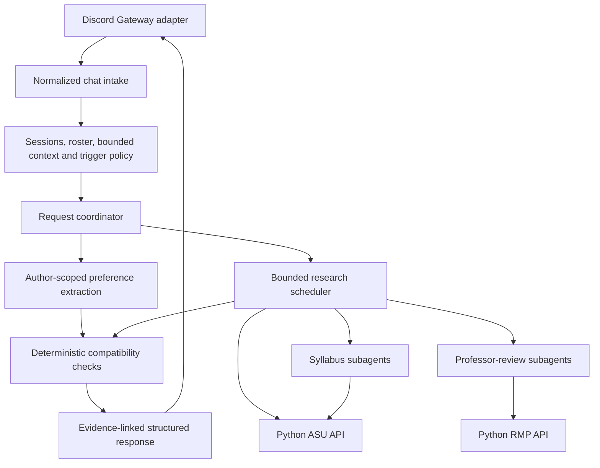

# SameSection Discord bot: implementation milestones

Plan accepted in principle by the team on October 24, 2026 (America/Phoenix). Application implementation has not started. Complete one milestone, report its evidence and limitations, and wait for the next milestone before continuing. This file is the canonical build checklist; it supersedes the earlier open interview questions where decisions are recorded below.

## 1. Agreed scope

- Build a Discord bot first, using a private text channel in a Discord server. Discord supplies the chat UI.
- Initial demo audience: ASU graduate CS students choosing electives. Use the ASU catalog integration; do not claim support for other universities or a complete degree audit.
- Students explicitly join planning through a button and receive a model-processing notice. Session membership is distinct from server/channel membership.
- Use a TypeScript coordinator with scoped research subagents, Zod validation, and SQLite persistence. Preserve the committed Python catalog/RMP services behind typed HTTP clients.
- Return ranked section shortlists, shared options, and individual alternatives. A shortlist is not a verified complete semester schedule; report any unchecked course-count, total-credit, prerequisite, or requirement-fulfillment dimension.
- Support mention-triggered group planning, participant-directed clarification, direct replies to outstanding questions, and individual course questions that do not alter profiles.
- Return useful results for participants with enough information. A silent registered participant stays unknown and is asked once; their silence does not block everyone else.
- Deploy a persistent bot with durable storage after local verification. Select hosting and budget at that stage rather than building cloud infrastructure now.
- Keep the planning core independent of Discord. An optional owned UI will initially have its own rooms; live Discord/web synchronization and account linking are deferred.
- Use focused functional verification. Do not pursue exhaustive combinations, coverage targets, load benchmarks, or repeated unrelated integration checks.

## 2. Documentation baseline

Current Discord documentation was consulted through the configured **Context7 MCP**, using `/discordjs/guide` and `/discord/discord-api-docs`. Context7 was reached through its configured MCP HTTP endpoint because its tools were not exposed directly in this chat. Library IDs were resolved before documentation queries. See [reference notes](discord-reference-notes.md) for sources and findings.

Important implementation constraints:

1. Use a persistent Gateway connection, with discord.js handling connection lifecycle. A request-only function is insufficient for listening to ordinary channel messages.
2. Request `Guilds`, `GuildMessages`, and `MessageContent`; enable Message Content Intent in the Developer Portal. An explicit join roster does not require subscribing to all guild-member events.
3. Use server installation with the bot and application-command capabilities, register commands to the development guild, and grant only channel/history/send/embed permissions needed by the bot. A local Gateway bot does not need a public interaction webhook or ngrok solely to receive its commands/buttons.
4. Acknowledge slash-command and button interactions within Discord's three-second deadline; defer slower work. Ordinary mention messages are a different event path: send a short normal acknowledgement before long research.
5. Route persistent join buttons through `interactionCreate` with persisted session identity, rather than relying on an in-memory collector surviving restarts.
6. Determine identity, mentions and replies from Discord metadata. Set explicit allowed mentions on all outbound paths; permit only intended participant IDs and suppress role/everyone pings.
7. Pin released dependencies and use the matching version's documentation. During planning, npm reported `discord.js 14.27.0` with Node `>=18`, whereas the documentation's moving `main` branch listed a newer runtime minimum. Select a supported runtime satisfying the pinned Discord, model-SDK, provider and SQLite dependencies together in Milestone 0.

## 3. Architecture and responsibilities



- **Transport:** discord.js objects, commands, buttons, message intake, safe mentions, acknowledgement, rendering and external-message references.
- **Application core:** internal identities, session authorization, profiles and sources, clarification state, request/profile versions, coordinator and response contracts.
- **Research:** typed API clients, scoped worker tools/results, identity resolution, task budgets, deduplication/cache, partial failure and evidence provenance.
- **Matching:** time/date overlap, availability, supplied course lists/rules, credits and hard/soft distinction. The model does not overrule a failed hard constraint.
- **Storage:** SQLite for sessions, participant identities, bounded messages, profiles, source references, clarification delivery IDs, request versions and research evidence. Keep writes short and outside network/model waits.

Workers return findings; only the coordinator sends responses. Catalog retrieval is ordinary code. A syllabus/review subagent is a bounded model invocation, not a separately deployed service or a permanent agent for every student. No additional orchestration framework is needed for this initial design.

Proposed layout, to establish during implementation:

```text
bot/
  src/
    transport/discord/
    application/
    domain/
    research/
    matching/
    persistence/
    rendering/
  tests/
  test-data/conversations/
  scripts/
class_search_api/          # preserve committed Python integration
rmp_api/                   # preserve committed Python integration
docs/
```

## 4. Milestone overview

| Milestone | Deliverable | Main verification |
| --- | --- | --- |
| 0 | Reconciled workspace, runtime/configuration plan, prepared mock-chat specification | Clean baseline and ready-to-use scenario definitions |
| 1 | Connected Discord bot with sessions, profiles and clarification workflow | Four-student replay plus a small real Discord interaction check |
| 2 | One live catalog question answered in Discord | One real selected-term course/instructor/seat query |
| 3 | Bounded parallel syllabus and professor research | Concurrency/partial-failure check plus one live research scenario |
| 4 | Shared and individual recommendations and refinement | Mock-chat replay using deterministic fit checks and a live-data demonstration |
| 5 | Persistent deployment and repeatable demo | Restart, real Discord smoke check and labeled synthetic-group demo |
| Optional 6 | Owned chat UI adapter | Same application behavior through independent web rooms |

### Milestone 0 — Prepare the implementation baseline and mock scenarios

**Build/preparation**

- Reconcile fetched API commit `ad226d4` with the local planning documents. The local branch was still unborn at the last inspection; preserve both the API code and these notes when establishing the working branch.
- Verify applicable repository instructions and current API contracts before editing. Keep the original working integrations intact.
- Select and pin mutually compatible runtime/package versions: TypeScript, discord.js, model SDK/OpenRouter provider, Zod, and a SQLite library. Verify the selected model/endpoint actually supports the required structured output and tool calls.
- Define a single local development startup procedure for the bot and the two Python services. Model credentials are needed for extraction/research; the existing Python services need no model key or student password.
- Prepare `.env.example` with names only. Proposed bot variables: `DISCORD_BOT_TOKEN`, `DISCORD_APPLICATION_ID`, `DISCORD_GUILD_ID`, `DISCORD_PLANNING_CHANNEL_IDS`, `OPENROUTER_API_KEY`, `OPENROUTER_MODEL`, `DATABASE_PATH`, `ASU_API_BASE_URL`, and `RMP_API_BASE_URL`. These are proposed bot configuration names, not claims about existing Python configuration.
- Provide a Developer Portal checklist: create application, enable the necessary intent, install in a private test server, and grant the selected channel permissions. Keep credentials out of chat, logs and Git.
- Adopt [mock chat scenarios](mock-chat-scenarios.md), including four synthetic actors, expected extracted preferences, and the silent-participant progression. Convert them to machine-readable replay fixtures in Milestone 1.

**Focused verification**

- Check the resulting repository includes both API directories and the planning documents, without credential files.
- Confirm the selected runtime meets actual pinned package engines and the sample configuration distinguishes required from optional values.
- Review the mock transcript and expected facts once. No broad API test rerun is needed merely for adding the bot scaffold or docs; the APIs were already validated in the [integration report](integration-validation.md).

**Done when:** the implementation can begin with a documented runtime, configuration, repository baseline and scenario specification. This milestone does not claim the bot is connected yet.

### Milestone 1 — Discord connection and the complete preference workflow

This is the original brief's first implementation milestone. Use the following small checkpoints within it; complete all before calling Milestone 1 done.

**1A. Transport and session setup**

- Connect the bot using Gateway events and provide a simple `/ping` smoke command.
- Implement `/plan start` with a semester and a session notice, then persistent **Join planning** and **Leave planning** buttons. The creator also explicitly joins. Permit one active session per configured channel initially.
- Persist membership using the interacting user's identity. Validate session/channel/status for every button click; recover the same routing after restart.
- Handle `/plan status`, the requester's profile view, their own profile reset, and session reset restricted to its creator or an authorized moderator. Destructive session reset gets a confirmation button tied to the authorized actor.
- Leaving excludes the student from subsequent planning/intake. Their own profile reset removes their profile and retained preference-source messages; an authorized session reset removes that session's profiles, context and clarifications. Keep these operations scoped to the correct actor/session.

**1B. Message intake and author-scoped preferences**

- Normalize messages, structured mentions and reply references into application-owned contracts. Store permitted joined-participant messages from the active session; do not backfill unrelated server history.
- Bound context, initially to the most recent 100 messages and 30,000 characters per session; retain previously extracted profile facts independently and disclose truncated context. These are configurable starting limits, not a claim of full-history understanding.
- Ordinary messages cause no model call or unsolicited response. An actual bot mention classifies the request and extracts applicable new preferences through validated structured output.
- Store hard constraints, soft preferences, explicit flexibility, unknowns, author/source message IDs and profile version. Preserve unspecified fields when applying corrections. Reject unsupported model output before committing state.
- Recognize individual course questions separately. At this milestone, mention the requester and clearly say research is not connected; do not fabricate an answer or modify their plan.

**1C. Clarification and delivery behavior**

- Identify missing information per participant and ask one decision-relevant question at a time for that person. Record pending question, target participant and every delivered Discord message ID used for reply routing.
- For three complete profiles and one silent participant, show a useful preference/coverage summary for three and ask the fourth once. Course recommendations begin only after research/matching milestones.
- Accept a direct reply from the intended student without another mention. A different student's reply does not establish the target's preferences. Do not repeatedly ping a silent participant.
- Ensure every send/edit uses explicit allowed mentions, handles platform length limits, and ignores bot/webhook-authored messages as normal student inputs.

**1D. Replay and state correctness**

- Convert the transcript into synthetic normalized events with separate actor IDs and expected facts; implement a replay runner using the same application handlers as Discord intake, with a separate test/development database.
- Deduplicate events and version requests/profiles. Snapshot the input used for work. A superseded request must not overwrite newer profiles or present itself as current; if new planning messages arrive during a group request, report that the snapshot needs refreshing rather than silently claiming they were included.
- Preserve state across process restart. Keep operational logs limited to IDs, status, latency and safe diagnostics.

**Focused verification**

- One replay covers four joins, ordinary-message silence, three author-scoped profiles, one silent participant, a direct clarification reply, an author correction, and an individual course question.
- Add small checks for duplicate-event suppression, an outdated request, and a reply by the wrong student. Check semantic facts, not exact model prose.
- With one real human account, verify `/ping`, start/join, actual mention detection, safe bot reply, direct reply routing and restart persistence in the test server.
- A small real model extraction check is needed when credentials are available. Deterministic model stubs can support isolated tests but do not prove the live model path.

**Done when:** this workflow works in replay and the real Discord transport checks pass, with research visibly disconnected. Report results and stop before Milestone 2.

### Milestone 2 — One complete live catalog path

**Build**

- Add typed clients for the committed catalog API. Resolve the selected semester/course and consume normalized sections with source IDs and retrieval timestamps.
- Answer “Who teaches CSE 512 in our selected semester, and what is the listed availability?” If the live source has no listing, report that accurately and use another real listed course for a positive smoke check.
- Render instructors, section identifiers, meeting information where available, nullable seats, ASU source links, coverage and timestamps. Clearly distinguish observations from eligibility or reservation.
- Keep syllabus/review research out of this narrow path. A seat-count request must not fan out to unrelated agents.

**Focused verification**

- One contract check covers a valid response and unknown seats/source failure using test-only injected data.
- Run one selected-term query against the real API and view the rendered answer in Discord. Do not rerun every course or every filter.

**Done when:** the live narrow question is answered with correct identity/provenance and no invented missing fields. Stop before Milestone 3.

### Milestone 3 — Parallel research with bounded behavior

**Build**

- Introduce an explicit task scheduler and validated worker envelopes with task/entity IDs, status, findings, sources, retrieval time, historical applicability and safe limitations/errors.
- Start from configurable limits: 12 candidate sections, 12 total research tasks per request, four concurrent tasks globally, two per source/model provider, four tool steps per worker, a 20-second worker deadline and a 90-second total request deadline. These are initial bounds to tune after the first run, not benchmarked performance guarantees. Stop expansion when a budget is reached and show partial coverage.
- Resolve exact offering identity before syllabus work. Try the selected term/class number first; use the agreed historical same-instructor then other-instructor fallback with clear labels. Return unavailable when text requires unimplemented OCR.
- Resolve professor candidates by school/name/department before review analysis. Ambiguity stays ambiguous. Preserve review dates, raw course labels, relevance and sample coverage.
- Deduplicate by evidence scope, reuse in-flight tasks and cache evidence. Initial freshness targets: seats two minutes; syllabus/review evidence 24 hours. Mark reused/stale evidence and refresh when required by the question.
- Honor `Retry-After`, avoid stacking coordinator retries on transport retries, and apply remaining time budgets to source calls. A timed-out coordinator task is not proof that an underlying Python request was cancelled.
- Preserve independent successes with settled-result handling. For within-worker review pagination, consume page routes incrementally so earlier successful pages remain usable after a later page fails.
- Give workers scoped context/tools. They return evidence and never post directly to Discord. Treat source text as untrusted evidence.

**Focused verification**

- One controlled scheduler check demonstrates overlap, concurrency limits, deduplication and a failing/timed-out sibling without losing successes.
- One small failure check covers rate-limit guidance or partial pagination; do not build an exhaustive provider-failure matrix.
- One live course/instructor scenario verifies syllabus provenance and RMP identity/reviews. Reuse the known CSE 575 scenario if still available, and report any source change accurately.

**Done when:** independent tasks run concurrently within bounds and the coordinator returns supported partial or complete research. Stop before Milestone 4.

### Milestone 4 — Shared recommendations and refinement

**Build**

- Retrieve candidates, apply cheap hard-constraint checks, then research a bounded shortlist. Do not research every instructor in the catalog.
- Check every meeting interval and relevant date; keep unknown times/availability visible. Validate student-supplied course/requirement rules; prerequisite text alone cannot establish eligibility.
- Rank compatible candidates by coverage first, then each student's soft-preference fit; present per-student fit rather than a single opaque group score. Do not penalize a candidate merely because another student's profile is unknown.
- Show shared options and individual alternatives, explain conflicts/no shared match, and offer backup sections when supported. Do not silently relax hard constraints.
- Explain which constraints were checked. Full schedule credit totals/course-count fulfillment remain unchecked unless actually computed across a complete proposed schedule.
- Support the fourth student's clarification, later corrections and refreshed recommendations. Keep individual questions separate from profile updates.
- Compare professors against expressed priorities, distinguishing student reviews from official course facts. No universal best-professor or easy-grade claim.

**Focused verification**

- Reuse the four-student replay with a tiny test-only section set to check time conflicts, unknowns, no shared match and individual alternatives deterministically.
- Run the synthetic conversation through the real model and live APIs for one labeled demonstration. Assert evidence/coverage behavior rather than fixed section names or changing seat counts.
- Confirm historical syllabus labels and individual question/profile separation in the rendered response.

**Done when:** the full synthetic group receives useful grounded recommendations and corrections refine only the appropriate profiles. Stop before Milestone 5.

### Milestone 5 — Deploy and prepare the repeatable demo

**Build**

- Choose an affordable persistent host with durable local SQLite storage and private connectivity to both Python services. Set provider keys/secrets through the host's configuration.
- Provide startup/restart instructions, basic health checks, session/profile reset controls, and a short demo runbook. Do not add Kubernetes, distributed queues, multiple bot replicas or a new database without an observed need.
- Keep the replay tool restricted to local/development or an explicitly configured demo environment. Any Discord replay output must be visibly labeled **Simulated student conversation** and must not ping invented participants as real accounts.
- Use live catalog/review/syllabus evidence for the product demonstration; never silently replace failed live APIs with synthetic course results.
- Capture a short demo showing the student problem, group request, silent fourth student, individual question, historical evidence and a correction. Document that multi-student behavior was simulated.

**Focused verification**

- One real Discord smoke pass exercises commands/buttons, mention request, safe response and a direct clarification reply.
- Restart the deployed process and verify profiles/session state and persistent join-button routing still work.
- Run the labeled four-student demo once and review sources/unknowns. Repeat only the parts affected by fixes.

**Done when:** the bot remains usable when the laptop is closed and the demo can be repeated without recruiting students. This is a synthetic usability demonstration, not proof that real students find it valuable.

### Optional Milestone 6 — Owned chat UI

Defer until the Discord product is complete. Add sign-in, independent rooms, message intake, mention controls, live delivery and rendering against the existing application contracts. Reuse planning/research/matching logic. Cross-platform account linking and Discord conversation synchronization remain out of scope for this first UI.

## 5. How to test without actual students

Use three complementary methods:

| Method | What is real | What it proves |
| --- | --- | --- |
| Focused automated replay | Core handlers; controlled model/API results only inside tests | Author isolation, constraints, routing, versions and failure handling |
| Development replay with live research | Synthetic student messages; real model and live ASU/RMP APIs | Full research/response path for a simulated group |
| Private-server smoke test | One real human account and real bot/Discord interactions | Gateway events, permissions, buttons, mentions, delivery and restart behavior |

Do not automate ordinary user accounts or pretend webhook/bot messages are distinct human students. The product intentionally ignores those messages. Synthetic actors enter through the development replay adapter, with clearly separated IDs and storage. A bot-posted transcript in Discord is presentation, not proof of receiving four authentic Discord user events.

**Mock data timing:** the readable scenario pack is provided now; machine-readable fixtures and the replay adapter are delivered in Milestone 1; test-only section/review/syllabus fixtures are added only as the relevant research/matching behavior is implemented. The product path always uses live research integrations.

## 6. Testing boundaries and milestone handoff

- Do not test third-party SDK internals, reproduce every existing API test, snapshot exact LLM wording, or pursue a coverage percentage.
- At each milestone, run type/build checks and the smallest set of functional checks covering the new behavior. Rerun existing checks when a shared behavior actually changed.
- Keep live model/source tests explicit, small and timestamped. Use fixture-based tests for controlled failures; disclose the distinction.
- Mark a milestone complete only when its required checks pass. If credentials or Discord setup prevent a required live check, record **implemented; live verification pending** rather than treating mock success as completion.
- Each handoff reports: behavior delivered, how to run it, checks performed, remaining live checks/limitations, changed files, and the next milestone. Update this checklist and pause before continuing.

## 7. Progress

- [x] Workflow and architecture discussed; recommended direction accepted.
- [x] Committed APIs inspected; 49 offline tests, lint and one live smoke path passed during the earlier review.
- [x] Current Discord guidance retrieved through Context7 MCP and official references.
- [x] Detailed milestone plan and readable synthetic conversation prepared.
- [ ] Milestone 0: implementation baseline and configuration/scenario setup.
- [ ] Milestone 1: complete Discord and preference workflow.
- [ ] Milestone 2: one live catalog path.
- [ ] Milestone 3: bounded parallel research.
- [ ] Milestone 4: group recommendations and refinement.
- [ ] Milestone 5: persistent deployment and demo.
- [ ] Optional Milestone 6: owned chat UI.
