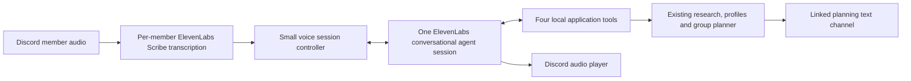

# Voice Ray: ElevenLabs demo milestones

Planned October 25, 2026 (America/Phoenix), against Track-3 branch `demo`; implemented on `codex/ray-voice` with live acceptance still pending. The progress notes distinguish code/tests from actual Discord voice proof. The user approved a modest scope, allowed difficult extras to be dropped, and subsequently authorized continuous implementation without waiting for milestone approvals. Use this checklist for the voice extension and the [main checklist](discord-bot-milestones.md) for existing text/research/planning work.

## Product scope

**Ray joins a Discord study-planning call, remembers each student's needs, answers course questions conversationally, and presents a recommendation for the group by name.**

The core demo supports one private server, one voice channel linked to one existing planning text channel, two to four opted-in students, and one worker process. Students usually take turns. A participant can interrupt Ray; robust interpretation of several humans talking simultaneously is deferred. The first target is a local session of up to 20 minutes, with clean manual rejoin afterward. This is a product cap, not a claim about provider session limits.

Required by the final milestone:

- A real ElevenLabs conversational agent with a friendly voice, short answers, follow-up context, and tools calling the existing Ray backend. Playing prerecorded replies or adding TTS alone does not satisfy the scope.
- Spoken course/catalog, syllabus and professor-review questions, using current backend evidence and limitations.
- Quiet, speaker-attributed discussion notes feeding the existing individual preference profiles; read-back and corrections.
- Explicitly requested group recommendations that address each member and finish with a short shared conclusion. Detailed options and sources appear in the linked text channel.
- Interruptible playback, visible listening state, join/leave and pause/resume controls, and a short session recap.

Optional after the core works: one helpful suggestion at a natural pause, with a cooldown. Skip automatic participation prompts, automatic recommendation generation, voice cloning, multiple voices, full-room diarization, simultaneous-speaker reasoning, autonomous voting/consensus detection, new university support, calendar/enrollment actions, an owned web UI, and a hosting migration for the voice demo.

## Smallest practical architecture

- Use `@discordjs/voice` for the voice connection and per-user audio subscriptions, decoding/resampling Discord audio into the selected ElevenLabs input format. Preserve Discord user ID before transcription. Use one shared conversational agent, not an agent per student. Separate transcription connections are bounded to the opted-in roster and cleaned up on pause/leave/disconnect.
- Use the ElevenLabs Agents WebSocket for text turns, context updates, tool calls and streamed audio. Dispatch client-tool calls in the Node worker and return their results over that connection; a browser is not required for this proposed custom client. Prove this in V0. Do not add public webhooks, a custom LLM endpoint, Speech Engine, a broker, or another workflow framework to the initial implementation.
- The controller handles identity, addressing, current speaker, session lifecycle, tool dispatch and audio cancellation. Existing application services retain preference extraction, source retrieval, ranking, authorization and persistence. The ElevenLabs LLM owns conversational wording; OpenRouter continues powering the existing backend tasks. Do not recreate ASU/RMP tools or schedule reasoning inside ElevenLabs.
- Start with four tools: `research_course`, `get_my_notes`, `recommend_group`, and `session_recap`. These are proposed names, not current exports. The backend flushes pending preference extraction before notes/recommendations. Tool context binds the authenticated requester and room; model arguments cannot select another actor or acquire moderator authority.
- Ordinary finalized utterances enter bounded participant context. Batch concise background updates to ElevenLabs; send a `user_message` when Ray is addressed or a valid follow-up arrives. Partial transcripts may assist interruption/address detection but never become persisted preference evidence.
- Reuse the linked text channel's canonical planning session and profiles. Audio utterances receive unique source IDs and author metadata. Reuse the existing recommendation `assignments`, section IDs and scoped evidence, extending the result minimally for spoken presentation; do not parse Discord Markdown to recover schedule decisions.
- Keep one active spoken request per room. While a tool runs, allow a brief acknowledgement and interruptions. Superseding requests invalidate old response/audio IDs. Informational research may finish and be cached, but an interrupted answer must never resume unexpectedly.
- Reuse existing text delivery/outbox semantics. Audio is ephemeral: never replay old spoken answers after restart. A lost ElevenLabs session is rejoined manually with bounded saved context; no seamless audio recovery promise.

## Milestones

| Milestone | Visible result | Exit evidence |
| --- | --- | --- |
| V0 — Prove the voice path | Ray joins, hears a question, calls a test tool, speaks and can be interrupted | Actual Discord + ElevenLabs round trip with two known users |
| V1 — Conversational course assistant | Ask a real syllabus/professor question and a follow-up | Real backend tool result, short voice answer and text citations |
| V2 — Remember the group | Ray recalls separate preferences and accepts corrections | Two-student isolation, read-back and text/voice continuity |
| V3 — Named recommendations | Ray explains each person's option and the shared choice | Real group planner output, matching spoken/text results |
| V4 — Repeatable demo | Clear controls, recap and a polished short demonstration | Two complete demo runs and focused failure checks |

### V0 — Prove Discord and ElevenLabs before building more

Build only the transport experiment and minimal controls:

- Add an opt-in voice feature flag, validated ElevenLabs credentials/agent/voice configuration, and pinned compatible audio dependencies. No voice configuration is required when the feature is off; preserve existing text startup. Do not print keys or signed session URLs.
- Add `/voice join` and `/voice leave` in an allowed planning text channel. Require an active planning session, existing joined membership, and the actor's presence in the permitted voice channel. Link to that planning channel. Add `GuildVoiceStates` and the required View Channel/Connect/Speak permissions; receiving requires the bot not to self-deafen. Joining planning plus accepting a clear voice-processing notice enables capture; mere channel presence does not.
- Verify the current voice library's DAVE/encryption support, per-user incoming audio, format conversion, Scribe transcription, one hosted conversational session, a harmless local test-tool round trip, and streamed Discord playback.
- Stop playback and clear queued/late chunks when a participant starts speaking. Use voice activity with a short noise filter; an interruption stops Ray even before the full transcript is available. Because the hosted agent receives transcribed text, its audio VAD alone cannot implement Discord interruptions.
- Show a compact voice status in the linked text channel. Leave stops capture and playback and closes sockets. Disconnect, process shutdown and the session time cap also clean up.

**Done:** two real test users are correctly identified; one asks Ray a question and hears a generated answer; a local test tool is called; the second can interrupt without old audio continuing; leave releases the connection. Record observed response/stop behavior without promising a latency benchmark.

**Cut rule:** spend at most one focused build/debug session on the transport proof, then record the specific blocker. If continuous recognition is unreliable, try push-to-talk/one-speaker turns while preserving real generated conversation. If audio reception itself fails, the in-channel conversational demo is blocked: continue shipping the existing text bot and document an optional linked browser voice alternative as a scope change. Do not silently substitute that for a working Discord voice demo. Do not build V2–V4 on an unverified audio path.

### V1 — Ask Ray about real classes

- Replace the test tool with `research_course` wrapping the existing research service. Pass the active semester and bounded relevant follow-up context; preserve exact-offering, historical-syllabus and unresolved-professor qualifications.
- Recognize “Hey Ray” / “Ray” in finalized text as addressing, rather than implementing a separate wake-word engine. During a short active exchange, accept a same-speaker follow-up without the name. Start with a configurable 30-second window, closed by a topic handoff, pause or leave. Other speakers address Ray to take the next turn.
- Answer in one to three conversational sentences. For slow research, acknowledge once, then present the result. Post the source-linked detail in the text channel. General friendly turns may be handled by the hosted agent; course facts must come from tools.
- Support barge-in during answers and tool waits. Track response IDs and tool request versions so interrupted output cannot play later. A correction becomes the next turn; tool completion alone does not re-open the previous turn.

**Done:** ask an actual course question, ask “what about its grading?” without repeating the course, and interrupt an answer. Check that a missing source yields a useful qualified answer and text citations, not fabricated policy. Notes/profile mutation is not a side effect of research.

### V2 — Quiet notes and individual preferences

- Retain bounded finalized utterances from opted-in members under the linked planning session, with stable author/source IDs. Exclude the bot, unjoined users and paused capture. Avoid a public transcript dump or saving raw audio in our app.
- Batch preference extraction on an addressed request, notes read-back or recommendation request. Do not run extraction or recommendations for every speech fragment. Maintain separate discussion context and validated profile versions, so ordinary chatter does not continually cancel an active plan. A relevant confirmed preference update still invalidates stale planning results.
- Add `get_my_notes`: “Ray, what do you have for me?” refreshes that speaker's pending preferences and reads a brief summary. “Actually, Friday mornings are fine” updates that speaker's facts. Cross-speaker claims do not overwrite someone else's profile; uncertain transcription of course codes/times prompts a short read-back.
- Reuse existing join/leave/reset and author-owned evidence validation. Extend the processing notice to explain ElevenLabs audio/transcript processing as well as OpenRouter extraction. Configure available provider recording/retention controls and document actual settings; do not promise zero retention without verification.
- Add `/voice pause` and `/voice resume` for the session owner/moderator. Pause stops forwarding audio and explicitly marks listening off. A student leaving planning immediately removes their audio subscription. Ordinary voice-channel join events never opt someone in automatically.

**Done:** two students give different work windows, one changes theirs, and Ray reads both profiles accurately without mixing authors. A subsequent text profile command reflects the same saved facts. Pause and leave stop new intake; existing reset removes the corresponding stored voice sources and invalidates pending work.

### V3 — Give each member a recommendation

- Add `recommend_group` wrapping the existing group planning application flow. Refresh all active participants' pending preferences before taking the snapshot. Generate only on an explicit request such as “Ray, what do you recommend for our group?” Treat this as a participant request; consensus detection and votes are unnecessary.
- Reuse deterministic constraints and existing assignments/evidence. Return compact structured results to the voice agent with names, courses, shared options, reasons and material unknowns. Keep academic eligibility, historical sources and incomplete meeting information qualified.
- Speak each member's display/preferred name and recommendation, then summarize what they can take together. Aim for roughly 30–60 seconds for a small group; post full details and links through the existing text delivery path. Say names aloud; only the text renderer creates validated Discord mentions.
- Support a follow-up “Why that course?” from the presented result. If a member corrects a constraint, refresh that member's facts and rerun when explicitly asked. Do not build a separate conversational optimizer or automatic rerun loop.

**Done:** a two-to-four-student live session produces real recommendations; named speech agrees with the posted assignments. A known hard conflict remains rejected, missing data remains unknown, and an interrupting correction prevents the older plan from being presented as current.

### V4 — Polish and rehearse the demo

- Add `session_recap`: a short spoken recap plus a single text summary of saved needs, latest options and unresolved questions. Invoking it does not imply everyone accepted a recommendation. `/voice leave` can offer the recap without generating it automatically on every disconnect.
- Keep one editable control/status message with Ray's state: listening, paused, researching, speaking or disconnected. Use the configured voice, a concise persona prompt and a small pronunciation/keyterm list for Ray, names and course identifiers.
- Set documented participant/duration/provider budgets and cleanly handle missing credentials, source failure, ElevenLabs disconnect and manual rejoin. Text commands remain available when voice fails. Verify local UDP connectivity; postpone hosted voice deployment until its network/audio support is checked.
- Optional only after the required demo passes: a facilitator toggle permitting at most one evidence-based suggestion per two minutes, at a pause, and only when there is a concrete useful observation. No idle chatter, invented course facts or automatic recommendations. Drop this feature first if timing or quality is unreliable.
- Document setup, the short demo script and observed limitations. Keep live provider costs explicit; use synthetic conversations for repeated automated checks and reserve live paid calls for focused integration checks.

**Done:** complete the script below twice without changing code between runs. Run focused checks for author isolation, follow-up routing, cancellation/late audio, profile-version guards, pause/leave and consistent spoken/text assignments, plus the existing build and affected regression suites. No exhaustive audio benchmark suite is required.

## Demo script: approximately three to five minutes

1. Start a normal Spring 2027 planning session, have two students join/opt in, and invite Ray to their voice channel.
2. Each student briefly states their interests and work hours. Ray quietly collects notes.
3. Ask “Hey Ray, what is this course about?” with a real course, then a syllabus/professor follow-up. Ray answers briefly and posts sources.
4. Interrupt Ray: “Actually, Friday morning works for me.” Ask for a notes read-back to show it remembered the right student.
5. Say “Okay Ray, recommend classes for us.” Hear a named recommendation for each student and the shared conclusion; inspect the full text result.
6. Ask “Why that option?”, then request a recap and leave. If a live source is unavailable, Ray explains that limitation and uses the available evidence. Never replace it with unlabeled fixture answers.

## Delivery priority and cut line

Order: verify any remaining Milestone 3/4 text smoke checks, V0, V1, V2, V3, V4, then optional deployment. V1 is the first independently useful voice feature; the target group demo includes V2 and V3. Optional proactivity is not a prerequisite for completion. Keep original milestone numbers; these V milestones extend the product before Milestone 5 deployment. The owned web UI stays deferred.

If time runs short, cut automatic suggestions, extra voices/persona work, simultaneous human speech handling and hosted deployment first. Preserve real conversational tools, clear speaker identity, notes, explicitly requested recommendations and stopping Ray when interrupted. A fundamental Discord/ElevenLabs connectivity failure must be reported as a blocker, not hidden by demo output.

## References verified during planning

- [ElevenLabs Agents WebSockets](https://elevenlabs.io/docs/eleven-agents/libraries/web-sockets): audio output, client tool events and interruption events.
- [Client-to-server events](https://elevenlabs.io/docs/eleven-agents/customization/events/client-to-server-events): background contextual updates versus user-message turns.
- [Realtime server-side transcription](https://elevenlabs.io/docs/eleven-api/guides/how-to/speech-to-text/realtime/server-side-streaming): live audio input and partial/committed transcripts.
- [Discord voice library](https://discord.js.org/docs/packages/voice/stable) and [installation/encryption support](https://discordjs.guide/voice): sending/receiving audio and dependency requirements. Audio reception is not documented by Discord; the library warns stable support is not guaranteed. V0 exists to test this risk in our actual setup.

## Progress

### October 25 scheduled build — V0 foundation

Created a dedicated ElevenLabs development agent (`bot/voice-agent.json`) through the plugin; unrelated agents were not changed. Read-back confirmed authenticated access, PCM 16 kHz output, voice recording disabled and one-day agent transcript retention. This is not zero retention; Scribe retention is separate. The local research client tool is attached. Added opt-in configuration, pinned Discord voice/DAVE and Opus/WebSocket dependencies, bounded Scribe utterance transport, private signed-URL agent transport, audio conversion, speaker/turn controller and Discord voice adapter foundation.

Five focused offline tests passed, including an actual synthetic Opus encode/decode, protocol tool dispatch, no late audio/tool result after cancellation, finalized transcription, consent/author isolation, follow-up ownership and pause. TypeScript build passed. These checks do not establish live provider or Discord audio behavior.

The project has Discord credentials but no `ELEVENLABS_API_KEY`, `ELEVENLABS_AGENT_ID` or configured voice channel. The plugin connection can manage agents but does not supply a runtime key to the Node worker. Set the dedicated agent ID from the manifest and a runtime key/channel locally before live Scribe/agent/Discord proof. No real two-person voice check has run; V0 remains incomplete. Continue independently testable wiring and later services as scaffolding, not as a claim that the live transport gate passed.

### V1 implementation wiring (live acceptance pending)

Added `/voice join consent:true`, leave, owner/moderator pause/resume/end, conditional voice-state intent, membership reconciliation and shutdown cleanup. The research client tool uses the existing research service, active semester, persisted per-user research context and text outbox. Calls are actor/session-bound, reject arbitrary tool names/extra identity arguments, propagate interruption cancellation and recheck membership/profile versions before publication. Each addressed spoken turn uses at most one agent connection; interruptions close it and the next turn restores bounded local conversation context. This deliberate reconnect simplifies late-audio suppression until the live transport is proven.

The build, 31 existing offline regressions and six voice checks pass. A command-contract expectation was updated for the added `/voice` command. Live syllabi/professor speech, follow-up timing and interruption latency remain unverified until runtime credentials and Discord participants are available. Quiet note intake is deliberately still a no-op here; V2 adds it, so V1 is not presented as note-taking support.

### V2–V3 implementation (live acceptance pending)

Quiet finalized voice messages now enter the shared bounded planning context with author/source IDs. They do not change validated profile versions or start models until a notes/recommendation checkpoint. Read-back refreshes only the speaker; group recommendation refreshes all joined participants. Course-information questions are excluded from preference evidence. Extraction validates author-owned quotes and rejects results after reset, new intake or competing profile changes. Existing text profile/reset behavior uses the same stored facts/sources; reset also clears ephemeral voice context.

The real planner now exposes spoken names, selected courses/sections, instructors, meetings, evidence-based reasons, shared options and limitations directly from the same allocation used for text. The voice wrapper publishes through the existing outbox, checks versions/cancellation and requires an explicit recommendation utterance before running that tool. It does not recover decisions by parsing Markdown or infer consent to a proposed schedule. The notes and recommendation tools are attached to the dedicated agent; recap is attached in preparation for V4.

Four isolated-Postgres voice regressions passed for separate notes/corrections, research-question isolation, reset during extraction, both-member refresh and cancellation before publication. The group suite passed (23 tests before adding one focused spoken/text allocation consistency check); the updated eight-test recommendation file and six voice protocol/controller tests passed. Live group readout remains pending; no voice milestone is marked complete.

### V4 implementation and current live gate

Added requested session recap, bounded question/output budgets, domain transcription keyterms, clear listening/paused/researching/speaking/disconnected status, developer setup instructions and a focused opt-in paid agent proof command. The agent closes after each completed response so idle provider turn timeouts cannot produce unsolicited speech. Agent settings read-back confirms four attached client tools, authenticated access, one concurrent call, a 100-call daily cap, no bursting/queue, no voice recording and one-day agent transcript retention. Automatic suggestions remain deferred.

Local checks loaded the actual Opus codec, DAVE native dependency and AES-256-GCM successfully. Seven voice protocol/controller/audio tests, five isolated-Postgres voice tests, the 31 existing offline regressions, ten planning storage regressions and the affected group/recommendation tests passed across focused runs; TypeScript build passed. The recap check preserves a silent member's unknown preferences and explicitly avoids claiming consensus. These are software checks, not live speaker/audio verification.

A read-only Discord API lookup found one regular voice channel, **General**. Its ID and the dedicated agent ID were added to the existing ignored `.env`, preserving other settings and keeping `VOICE_ENABLED=false`. The final `npm run check:voice` reports only `ELEVENLABS_API_KEY` missing. The connected plugin manages agents but cannot supply the local runtime credential. Add a same-workspace runtime key privately to `.env`, run the opt-in provider proof, enable voice/register commands, then perform the two-person Discord proof and two rehearsals. No credentials or student voice data were committed. The goal remains incomplete pending this real integration/acceptance work; no live milestone checkbox is checked.

The pre-existing local supervisor/Gateway worker was still running and was left intact. No second live worker or voice probe was started against it, and live commands were not re-registered during this unconfigured build. The one-time scheduled kickoff was deleted after dispatch; continued work belongs to the persistent goal rather than duplicate scheduled builds.

### Follow-up cancellation audit

Found and fixed a transcript-admission race: an utterance waiting on authorization or note storage could otherwise reopen the provider after pause/resume, context reset or leave/rejoin. Admission now carries an abort signal through the local note transaction, and interruption invalidates pending admissions before they can start a provider turn. Eight voice regressions and six isolated-Postgres voice regressions passed, including all six lifecycle/wait combinations and prevention of retaining a cancelled source after reset. Build passed. Rechecking setup still reports only the missing runtime key; no live verification is inferred from these tests.

### Runtime key supplied — live transport checks

The user supplied the runtime key privately. Agent read and signed-URL access returned HTTP 200. The first live tool round trip exposed a real protocol omission: successful `client_tool_result` messages require `is_error:false`. Fixed it and added a wire-contract regression. Actual voice sessions also omitted the configured `agent_response_complete` event; the bridge now has a bounded two-second quiet-audio completion fallback after final answer text, disabled while tools are pending. The new regression verifies that a pre-tool acknowledgement or a delayed tool result does not prematurely finish a turn. Build and nine voice tests passed.

The combined opt-in live probe passed with one local notes-tool call and 261,120 bytes of generated PCM speech. Reusing that synthetic audio through Scribe produced a 149-character finalized transcript. No student audio or text-chat fixtures were used or posted. The probe paces audio like a microphone to respect the five-second pre-readiness buffer. This verifies authenticated agent conversation, local tool response, speech generation and realtime transcription; it does not verify Discord microphone capture or human audibility.

With the normal worker stopped and General empty, the Discord proof reached a ready voice connection and finished half a second of silent raw-PCM playback through the actual encoding/transport path. No member audio was captured. Afterwards enabled voice in the ignored local `.env`, registered `/voice` commands, and started the single local supervisor/worker. Startup confirmed Voice Ray controls and Gateway readiness; the database and both Python APIs passed health checks. Real participant read-back, interruptions, named group results and two rehearsals remain pending. The user has been invited to perform the live check; no milestone is marked complete on the strength of the synthetic or silent probes alone.

### First real microphone troubleshooting

The user reported no audible response. Read-only state checks confirmed that Ray was connected and neither muted nor deafened. Metadata-only capture diagnostics then verified full human utterance delivery through Discord decode and realtime transcription (one capture contained 128 packets / 81,920 PCM bytes and a 37-character transcript). This proves the microphone-to-transcription path for that participant, not human playback or two-speaker isolation.

The trace exposed an observed `E-RAY` wake-phrase transcription variant and a provider capacity rejection when an interrupted connection was immediately replaced in the one-conversation workspace. Added the narrow wake-phrase variant and serialized reconnects behind socket-close acknowledgement plus a short cleanup interval. Eleven voice tests and build pass, including a close-acknowledgement regression. Headphones/one-question-then-pause are used to distinguish acoustic re-triggering from intended interruptions. Audible replies and the full group rehearsal remain unverified until the user confirms them.

Further capture traces showed some utterances persisting to the 30-second cap despite packet gaps. Switched Scribe to speech-based VAD commits while retaining the explicit end/deadline commit. Also fixed an empty-transcript terminal path that closed Scribe without notifying the caller, potentially leaving the member's capture slot occupied indefinitely. Empty results now always release capture and never become profile evidence. Twelve voice regressions and build passed; a new live agent/tool/speech/VAD transcription proof passed with 253,440 PCM bytes and a 144-character synthetic transcript. The listening worker was reloaded for the user's next real check; human playback is still pending.

After rejoining and asking the notes read-back question once, the user explicitly confirmed **“Ray answered aloud.”** This establishes the basic real Discord microphone → transcription → local notes tool → agent speech → human-audible playback path for one participant on this code. Keep Ray running for further testing. This single confirmation does not verify two-speaker isolation, course-source follow-ups, interruption recovery, named group recommendations or the two full rehearsals.

### Dedicated channels, natural female voice and post-tool speech

At the user's request, local configuration now points to voice channel `1563952043130101840` (**ray-help**) and text channel `1563952319450718308` (**ray-voice-help**). Read-only Discord checks verified both types and the configured guild. The dedicated text channel is allowlisted for planning/voice controls and receives that workspace's source-linked results; voice commands in the old main text channel receive a private redirect. Existing main planning channels and state remain unchanged. Discord may still suggest the guild slash command in its picker; the bot enforces channel restriction when invoked rather than disabling unrelated main-channel commands.

Switched the dedicated agent to the verified Jessica female conversational voice, retained its low-latency audio model, and updated the complete saved prompt for warmer concise dialogue, a join greeting and mandatory spoken answers after tool results. Read-back verified the voice ID and prompt. Greetings are server events, do not become participant evidence and cannot invoke tools. The original acknowledgement no longer counts as final-answer audio: the bridge resets its speech-completion gate at tool return and waits for fresh audio before closing the response. A live deliberately delayed-tool check produced 409,600 PCM bytes total, including 330,240 after the tool result.

Added a configurable sustained-speech energy gate to suppress quiet background/comfort noise and isolated clicks before interruption or ASR startup, while preserving the initial buffered speech. Build, 15 voice tests and 31 existing offline regressions passed. Tests cover dedicated command routing, greeting isolation, quiet-noise rejection and delayed final speech. The worker was restarted with the requested channels. Human confirmation of the new voice/greeting and real course-answer readout remains pending.

- [ ] V0: one participant's complete real microphone/notes-tool/spoken-answer path confirmed by the user; two-speaker isolation and interruptions pending.
- [ ] V1: course tool and follow-up code tested; live spoken questions pending.
- [ ] V2: separate notes/corrections/reset tested with isolated Postgres; live speaker recognition and read-back pending.
- [ ] V3: named allocation presentation and stale-result guards tested; live group readout pending.
- [ ] V4: controls/recap/setup checks implemented; two complete live rehearsals pending. Optional proactivity deferred.

### Explicit-address and guest voice update — October 25

Latest user requirements supersede the earlier automatic follow-up window and mandatory planning enrollment for voice. Every spoken request must address Ray, including follow-ups. Ordinary discussion remains bounded, speaker-attributed pending evidence and no longer cancels an active researched answer. Scribe partial transcripts allow a recognized Ray address to interrupt playback; this has transcription latency and is not instantaneous voice-activity interruption.

Voice opt-in is separate from planning enrollment. `/voice join consent:true` can initialize a voice-only workspace without inventing a semester. Guests can research courses and refresh/read their own notes; `/plan start` promotes the same workspace and preserves notes. Planning leave preserves pending voice notes and does not revoke audio consent; `/voice leave` does. Recommendations require requester enrollment and include only enrolled members, with an invitation for omitted guests. Profile reset remains available to guests. Passive sources are extracted at notes/recap/recommendation checkpoints, not with a model call on every utterance.

The dedicated Jessica female voice and warm greeting remain configured. Provider prompt was read, updated through ElevenLabs tools, and verified. Text delivery runs independently after the result is durably queued so a Discord delivery failure cannot discard a successful spoken tool answer. Dedicated ray-help / ray-voice-help channel IDs remain configured locally; voice controls in the original main channel remain blocked with a private redirect.

Validation: TypeScript build; 18 voice tests; 7 voice/planning database tests; 10 planning database regressions; 24 group regressions; 31 foundation/research regressions. One bounded live synthetic ElevenLabs delayed-tool check returned 419840 PCM bytes total, including 337920 bytes after the tool result. This verifies provider-generated final speech, not Discord microphone/playback acceptance. The single worker was restarted. Pending human checks: guest joining without planning, real course answers aloud while friends talk, explicit-Ray interruptions, two-person attribution, and group recommendation rehearsal. No new live-human acceptance is claimed.

### Topic discovery, conversational continuity and playback update — October 25

The screenshot exposed a real missing capability: the research task schema required exact course identities and the API's singular `keyword` parameter was forwarded unchanged, whereas ASU filters by native `keywords`. Both paths are fixed. Keyword discovery can search across departments without invented course codes; it retains bounded distinct-course representatives and coverage metadata. Discovered identities can ground a second batch of syllabus/review tasks (up to two courses by prompt, within the existing task/source/deadline limits). Exact-course mixed-source research remains available. A grounded topic-modifier fallback covers a provider omitting its keyword field; absent/relative semesters still require clarification rather than a guessed year.

Pending requests now persist in per-user research memory so a semester clarification retains the topic. Recent explicit semester corrections take precedence over older task scope. Ephemeral voice context is speaker-scoped with twelve bounded entries; consecutive acknowledgement/final text replaces one Ray entry instead of evicting the user goal. Bare “Ray” and “Ray, question” are valid addresses. Every actual request still addresses Ray; other opted-in discussion remains passive notes and does not cancel or restart a pending answer.

Provider traces for the two recent reported course conversations contained generated final responses but marked them interrupted after client disconnect. Completion previously treated a two-second network gap as final; it now waits for the estimated playback duration of queued PCM plus the quiet interval. The trace evidence identifies premature client termination; it does not independently prove what Discord participants heard.

Validation: build; 35 research/foundation regressions; 20 voice regressions; 7 voice/planning database regressions; 18 focused Python catalog tests. Regression coverage includes topic → semester → discovered-course syllabus/RMP dispatch, omitted keyword fields, correct ASU filter forwarding, bare Ray, speaker isolation, and audio chunks arriving across synthesis gaps. Live ASU keyword retrieval returned 29 Spring 2027 sections covering 12 distinct database-related courses. A live two-turn research check first asked the semester and then returned the real keyword results for Spring 2027. One final paid ElevenLabs-to-real-catalog tool proof generated 939520 PCM bytes, including 883200 bytes after the result; no Discord messages or synthetic participant claims were created. The development agent prompt was read, updated through ElevenLabs, and verified. Worker restarted with these changes.

Remaining human acceptance: hear a full real catalog answer in ray-help, repeat the topic/semester flow with “Ray”, speak to a friend during lookup/playback without interrupting Ray, and test two-person notes plus explicit-Ray interruption/recovery. These manual gates remain pending.

### Active conversation routing — October 25

The latest user request replaces the wake-word requirement. Opted-in audio is transcribed as before; each finalized utterance now gets one bounded semantic routing decision (`listen`, `reply`, or `stop`) using the established speaker, opted-in roster, sixteen recent attributed human/Ray entries and whether Ray is busy. Requests and clarification answers do not require Ray's name. Ordinary discussion supplies shared context without a spoken acknowledgement. The router reconstructs a faithful request with known topic/course/semester, and the conversational agent receives both original speech and resolved context. Personal profile evidence remains bound to the actual author. Planning enrollment gates remain unchanged.

A new routed question stops the old player/provider and aborts its tools; a stop-only request stops without opening another provider call. Human speech alone still does not cancel a response. Interruption recognition waits for final transcription and the semantic decision, so it has a short delay. Decisions are serialized to preserve order; replacing Ray's answer does not discard queued human turns. Pause/reset/leave/end revoke pending decisions. The router has an eight-second maximum model timeout and no provider retries. If it is unavailable, ordinary speech stays as notes and an optional explicit Ray address remains usable. The existing session duration, participant and reply budgets remain in place.

The consent notice now explicitly describes transcript processing by OpenRouter for reply routing. The hosted development agent prompt was read, updated to remove the required address, and verified. No other agent was changed. Shared recent context is bounded and ephemeral; existing persisted notes and per-user research context retain their established behavior. This does not claim unlimited meeting recall or perfect addressee inference.

Validation: TypeScript build, 25 voice tests, 35 foundation/research regressions and 7 voice/planning database tests passed. New tests cover passive context feeding a question without a name, a semester clarification without a name, friend-directed speech during playback, new-question interruption, stop, queued decision order, pause cancellation, routing outage and the actual structured model request. Four bounded live synthetic routing checks passed: unnamed database request with inherited Spring 2027; Bob-directed lunch question ignored; replacement syllabus question recognized with semester; stop recognized. No new live-human Discord acceptance or audio playback is claimed. The single development worker was restarted with the new router.

Pending human check: opt into ray-help again, mention a semester in discussion, ask an unnamed class question, talk to a friend while Ray researches/speaks, then ask a replacement question without saying Ray. Confirm speech, context selection, silence during side conversation and interruption recovery.
