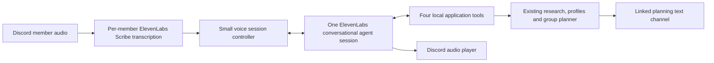

# Voice Ray: ElevenLabs demo milestones

Planned October 25, 2026 (America/Phoenix), against Track-3 branch `demo`. This is a planning document; no voice capability has been implemented or verified yet. The user approved a modest voice scope and explicitly allowed difficult extras to be dropped. Use this checklist for the voice extension and the [main checklist](discord-bot-milestones.md) for existing text/research/planning work. Implement one milestone at a time and record actual verification before moving on.

## Product scope

**Ray joins a Discord study-planning call, remembers each student's needs, answers course questions conversationally, and presents a recommendation for the group by name.**

The core demo supports one private server, one voice channel linked to one existing planning text channel, two to four opted-in students, and one worker process. Students usually take turns. A participant can interrupt Ray; robust interpretation of several humans talking simultaneously is deferred. The first target is a local session of up to 20 minutes, with clean manual rejoin afterward. This is a product cap, not a claim about provider session limits.

Required by the final milestone:

- A real ElevenLabs conversational agent with a friendly voice, short answers, follow-up context, and tools calling the existing Ray backend. Playing prerecorded replies or adding TTS alone does not satisfy the scope.
- Spoken course/catalog, syllabus and professor-review questions, using current backend evidence and limitations.
- Quiet, speaker-attributed discussion notes feeding the existing individual preference profiles; read-back and corrections.
- Explicitly requested group recommendations that address each member and finish with a short shared conclusion. Detailed options and sources appear in the linked text channel.
- Interruptible playback, visible listening state, join/leave and pause/resume controls, and a short session recap.

Optional after the core works: one helpful suggestion at a natural pause, with a cooldown. Skip automatic participation prompts, automatic recommendation generation, voice cloning, multiple voices, full-room diarization, simultaneous-speaker reasoning, autonomous voting/consensus detection, new university support, calendar/enrollment actions, an owned web UI, and a hosting migration for the voice demo.

## Smallest practical architecture

- Use `@discordjs/voice` for the voice connection and per-user audio subscriptions, decoding/resampling Discord audio into the selected ElevenLabs input format. Preserve Discord user ID before transcription. Use one shared conversational agent, not an agent per student. Separate transcription connections are bounded to the opted-in roster and cleaned up on pause/leave/disconnect.
- Use the ElevenLabs Agents WebSocket for text turns, context updates, tool calls and streamed audio. Dispatch client-tool calls in the Node worker and return their results over that connection; a browser is not required for this proposed custom client. Prove this in V0. Do not add public webhooks, a custom LLM endpoint, Speech Engine, a broker, or another workflow framework to the initial implementation.
- The controller handles identity, addressing, current speaker, session lifecycle, tool dispatch and audio cancellation. Existing application services retain preference extraction, source retrieval, ranking, authorization and persistence. The ElevenLabs LLM owns conversational wording; OpenRouter continues powering the existing backend tasks. Do not recreate ASU/RMP tools or schedule reasoning inside ElevenLabs.
- Start with four tools: `research_course`, `get_my_notes`, `recommend_group`, and `session_recap`. These are proposed names, not current exports. The backend flushes pending preference extraction before notes/recommendations. Tool context binds the authenticated requester and room; model arguments cannot select another actor or acquire moderator authority.
- Ordinary finalized utterances enter bounded participant context. Batch concise background updates to ElevenLabs; send a `user_message` when Ray is addressed or a valid follow-up arrives. Partial transcripts may assist interruption/address detection but never become persisted preference evidence.
- Reuse the linked text channel's canonical planning session and profiles. Audio utterances receive unique source IDs and author metadata. Reuse the existing recommendation `assignments`, section IDs and scoped evidence, extending the result minimally for spoken presentation; do not parse Discord Markdown to recover schedule decisions.
- Keep one active spoken request per room. While a tool runs, allow a brief acknowledgement and interruptions. Superseding requests invalidate old response/audio IDs. Informational research may finish and be cached, but an interrupted answer must never resume unexpectedly.
- Reuse existing text delivery/outbox semantics. Audio is ephemeral: never replay old spoken answers after restart. A lost ElevenLabs session is rejoined manually with bounded saved context; no seamless audio recovery promise.

## Milestones

| Milestone | Visible result | Exit evidence |
| --- | --- | --- |
| V0 — Prove the voice path | Ray joins, hears a question, calls a test tool, speaks and can be interrupted | Actual Discord + ElevenLabs round trip with two known users |
| V1 — Conversational course assistant | Ask a real syllabus/professor question and a follow-up | Real backend tool result, short voice answer and text citations |
| V2 — Remember the group | Ray recalls separate preferences and accepts corrections | Two-student isolation, read-back and text/voice continuity |
| V3 — Named recommendations | Ray explains each person's option and the shared choice | Real group planner output, matching spoken/text results |
| V4 — Repeatable demo | Clear controls, recap and a polished short demonstration | Two complete demo runs and focused failure checks |

### V0 — Prove Discord and ElevenLabs before building more

Build only the transport experiment and minimal controls:

- Add an opt-in voice feature flag, validated ElevenLabs credentials/agent/voice configuration, and pinned compatible audio dependencies. No voice configuration is required when the feature is off; preserve existing text startup. Do not print keys or signed session URLs.
- Add `/voice join` and `/voice leave` in an allowed planning text channel. Require an active planning session, existing joined membership, and the actor's presence in the permitted voice channel. Link to that planning channel. Add `GuildVoiceStates` and the required View Channel/Connect/Speak permissions; receiving requires the bot not to self-deafen. Joining planning plus accepting a clear voice-processing notice enables capture; mere channel presence does not.
- Verify the current voice library's DAVE/encryption support, per-user incoming audio, format conversion, Scribe transcription, one hosted conversational session, a harmless local test-tool round trip, and streamed Discord playback.
- Stop playback and clear queued/late chunks when a participant starts speaking. Use voice activity with a short noise filter; an interruption stops Ray even before the full transcript is available. Because the hosted agent receives transcribed text, its audio VAD alone cannot implement Discord interruptions.
- Show a compact voice status in the linked text channel. Leave stops capture and playback and closes sockets. Disconnect, process shutdown and the session time cap also clean up.

**Done:** two real test users are correctly identified; one asks Ray a question and hears a generated answer; a local test tool is called; the second can interrupt without old audio continuing; leave releases the connection. Record observed response/stop behavior without promising a latency benchmark.

**Cut rule:** spend at most one focused build/debug session on the transport proof, then record the specific blocker. If continuous recognition is unreliable, try push-to-talk/one-speaker turns while preserving real generated conversation. If audio reception itself fails, the in-channel conversational demo is blocked: continue shipping the existing text bot and document an optional linked browser voice alternative as a scope change. Do not silently substitute that for a working Discord voice demo. Do not build V2–V4 on an unverified audio path.

### V1 — Ask Ray about real classes

- Replace the test tool with `research_course` wrapping the existing research service. Pass the active semester and bounded relevant follow-up context; preserve exact-offering, historical-syllabus and unresolved-professor qualifications.
- Recognize “Hey Ray” / “Ray” in finalized text as addressing, rather than implementing a separate wake-word engine. During a short active exchange, accept a same-speaker follow-up without the name. Start with a configurable 30-second window, closed by a topic handoff, pause or leave. Other speakers address Ray to take the next turn.
- Answer in one to three conversational sentences. For slow research, acknowledge once, then present the result. Post the source-linked detail in the text channel. General friendly turns may be handled by the hosted agent; course facts must come from tools.
- Support barge-in during answers and tool waits. Track response IDs and tool request versions so interrupted output cannot play later. A correction becomes the next turn; tool completion alone does not re-open the previous turn.

**Done:** ask an actual course question, ask “what about its grading?” without repeating the course, and interrupt an answer. Check that a missing source yields a useful qualified answer and text citations, not fabricated policy. Notes/profile mutation is not a side effect of research.

### V2 — Quiet notes and individual preferences

- Retain bounded finalized utterances from opted-in members under the linked planning session, with stable author/source IDs. Exclude the bot, unjoined users and paused capture. Avoid a public transcript dump or saving raw audio in our app.
- Batch preference extraction on an addressed request, notes read-back or recommendation request. Do not run extraction or recommendations for every speech fragment. Maintain separate discussion context and validated profile versions, so ordinary chatter does not continually cancel an active plan. A relevant confirmed preference update still invalidates stale planning results.
- Add `get_my_notes`: “Ray, what do you have for me?” refreshes that speaker's pending preferences and reads a brief summary. “Actually, Friday mornings are fine” updates that speaker's facts. Cross-speaker claims do not overwrite someone else's profile; uncertain transcription of course codes/times prompts a short read-back.
- Reuse existing join/leave/reset and author-owned evidence validation. Extend the processing notice to explain ElevenLabs audio/transcript processing as well as OpenRouter extraction. Configure available provider recording/retention controls and document actual settings; do not promise zero retention without verification.
- Add `/voice pause` and `/voice resume` for the session owner/moderator. Pause stops forwarding audio and explicitly marks listening off. A student leaving planning immediately removes their audio subscription. Ordinary voice-channel join events never opt someone in automatically.

**Done:** two students give different work windows, one changes theirs, and Ray reads both profiles accurately without mixing authors. A subsequent text profile command reflects the same saved facts. Pause and leave stop new intake; existing reset removes the corresponding stored voice sources and invalidates pending work.

### V3 — Give each member a recommendation

- Add `recommend_group` wrapping the existing group planning application flow. Refresh all active participants' pending preferences before taking the snapshot. Generate only on an explicit request such as “Ray, what do you recommend for our group?” Treat this as a participant request; consensus detection and votes are unnecessary.
- Reuse deterministic constraints and existing assignments/evidence. Return compact structured results to the voice agent with names, courses, shared options, reasons and material unknowns. Keep academic eligibility, historical sources and incomplete meeting information qualified.
- Speak each member's display/preferred name and recommendation, then summarize what they can take together. Aim for roughly 30–60 seconds for a small group; post full details and links through the existing text delivery path. Say names aloud; only the text renderer creates validated Discord mentions.
- Support a follow-up “Why that course?” from the presented result. If a member corrects a constraint, refresh that member's facts and rerun when explicitly asked. Do not build a separate conversational optimizer or automatic rerun loop.

**Done:** a two-to-four-student live session produces real recommendations; named speech agrees with the posted assignments. A known hard conflict remains rejected, missing data remains unknown, and an interrupting correction prevents the older plan from being presented as current.

### V4 — Polish and rehearse the demo

- Add `session_recap`: a short spoken recap plus a single text summary of saved needs, latest options and unresolved questions. Invoking it does not imply everyone accepted a recommendation. `/voice leave` can offer the recap without generating it automatically on every disconnect.
- Keep one editable control/status message with Ray's state: listening, paused, researching, speaking or disconnected. Use the configured voice, a concise persona prompt and a small pronunciation/keyterm list for Ray, names and course identifiers.
- Set documented participant/duration/provider budgets and cleanly handle missing credentials, source failure, ElevenLabs disconnect and manual rejoin. Text commands remain available when voice fails. Verify local UDP connectivity; postpone hosted voice deployment until its network/audio support is checked.
- Optional only after the required demo passes: a facilitator toggle permitting at most one evidence-based suggestion per two minutes, at a pause, and only when there is a concrete useful observation. No idle chatter, invented course facts or automatic recommendations. Drop this feature first if timing or quality is unreliable.
- Document setup, the short demo script and observed limitations. Keep live provider costs explicit; use synthetic conversations for repeated automated checks and reserve live paid calls for focused integration checks.

**Done:** complete the script below twice without changing code between runs. Run focused checks for author isolation, follow-up routing, cancellation/late audio, profile-version guards, pause/leave and consistent spoken/text assignments, plus the existing build and affected regression suites. No exhaustive audio benchmark suite is required.

## Demo script: approximately three to five minutes

1. Start a normal Spring 2027 planning session, have two students join/opt in, and invite Ray to their voice channel.
2. Each student briefly states their interests and work hours. Ray quietly collects notes.
3. Ask “Hey Ray, what is this course about?” with a real course, then a syllabus/professor follow-up. Ray answers briefly and posts sources.
4. Interrupt Ray: “Actually, Friday morning works for me.” Ask for a notes read-back to show it remembered the right student.
5. Say “Okay Ray, recommend classes for us.” Hear a named recommendation for each student and the shared conclusion; inspect the full text result.
6. Ask “Why that option?”, then request a recap and leave. If a live source is unavailable, Ray explains that limitation and uses the available evidence. Never replace it with unlabeled fixture answers.

## Delivery priority and cut line

Order: verify any remaining Milestone 3/4 text smoke checks, V0, V1, V2, V3, V4, then optional deployment. V1 is the first independently useful voice feature; the target group demo includes V2 and V3. Optional proactivity is not a prerequisite for completion. Keep original milestone numbers; these V milestones extend the product before Milestone 5 deployment. The owned web UI stays deferred.

If time runs short, cut automatic suggestions, extra voices/persona work, simultaneous human speech handling and hosted deployment first. Preserve real conversational tools, clear speaker identity, notes, explicitly requested recommendations and stopping Ray when interrupted. A fundamental Discord/ElevenLabs connectivity failure must be reported as a blocker, not hidden by demo output.

## References verified during planning

- [ElevenLabs Agents WebSockets](https://elevenlabs.io/docs/eleven-agents/libraries/web-sockets): audio output, client tool events and interruption events.
- [Client-to-server events](https://elevenlabs.io/docs/eleven-agents/customization/events/client-to-server-events): background contextual updates versus user-message turns.
- [Realtime server-side transcription](https://elevenlabs.io/docs/eleven-api/guides/how-to/speech-to-text/realtime/server-side-streaming): live audio input and partial/committed transcripts.
- [Discord voice library](https://discord.js.org/docs/packages/voice/stable) and [installation/encryption support](https://discordjs.guide/voice): sending/receiving audio and dependency requirements. Audio reception is not documented by Discord; the library warns stable support is not guaranteed. V0 exists to test this risk in our actual setup.

## Progress

### October 25 scheduled build — V0 foundation

Created a dedicated ElevenLabs development agent (`bot/voice-agent.json`) through the plugin; unrelated agents were not changed. Read-back confirmed authenticated access, PCM 16 kHz output, voice recording disabled and one-day agent transcript retention. This is not zero retention; Scribe retention is separate. The local research client tool is attached. Added opt-in configuration, pinned Discord voice/DAVE and Opus/WebSocket dependencies, bounded Scribe utterance transport, private signed-URL agent transport, audio conversion, speaker/turn controller and Discord voice adapter foundation.

Five focused offline tests passed, including an actual synthetic Opus encode/decode, protocol tool dispatch, no late audio/tool result after cancellation, finalized transcription, consent/author isolation, follow-up ownership and pause. TypeScript build passed. These checks do not establish live provider or Discord audio behavior.

The project has Discord credentials but no `ELEVENLABS_API_KEY`, `ELEVENLABS_AGENT_ID` or configured voice channel. The plugin connection can manage agents but does not supply a runtime key to the Node worker. Set the dedicated agent ID from the manifest and a runtime key/channel locally before live Scribe/agent/Discord proof. No real two-person voice check has run; V0 remains incomplete. Continue independently testable wiring and later services as scaffolding, not as a claim that the live transport gate passed.

- [ ] V0: voice transport and conversational tool proof.
- [ ] V1: live conversational course questions.
- [ ] V2: separate student notes and corrections.
- [ ] V3: named group recommendations.
- [ ] V4: controls, recap and repeatable demo.
