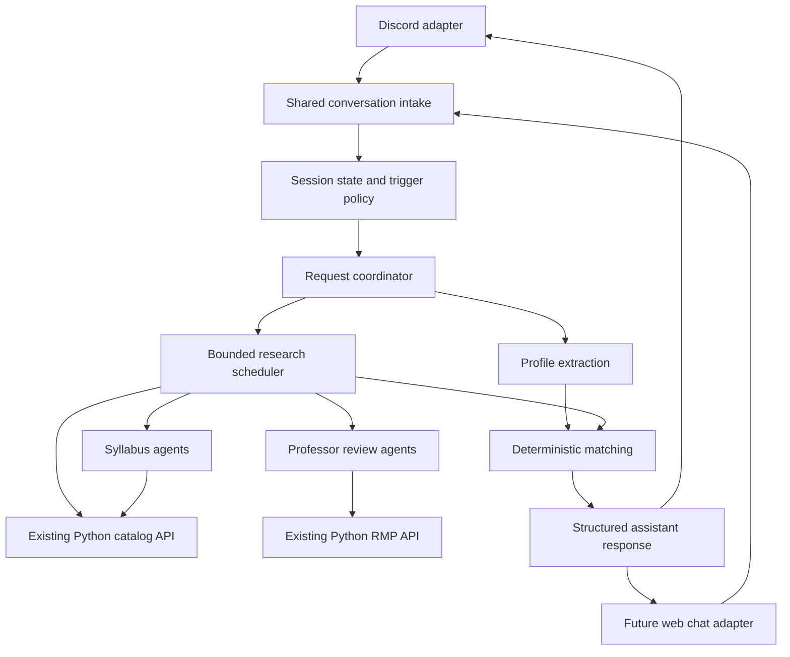

# SameSection workflow and architecture

Status: the team accepted the recommended direction on October 24, 2026. Use [Discord bot milestones](discord-bot-milestones.md) as the canonical build checklist. This document explains the architecture; it does not report implemented bot functionality.

## Product workflow

1. Students use a private text channel in a Discord server with SameSection installed. An ordinary Discord bot cannot join a group DM. See [Discord's bot account restrictions](https://docs.discord.com/developers/topics/oauth2#bot-vs-user-accounts).
2. Establish a planning session, semester, participant roster, and model-processing notice. Students explicitly use Join planning; a channel's accessible members are not automatically its participants.
3. Students discuss requirements, hard constraints, soft preferences, and explicit flexibility naturally. Store bounded session messages without calling a model for every message.
4. An actual mention of the assistant triggers a request. Deterministic code recognizes actual mention metadata or a reply to an outstanding clarification addressed to its author.
5. Classify the request as group planning, a course question, or a profile/session control. For group planning, extract each participant's statements separately, retain source-message references, and apply author-scoped corrections.
6. Research useful options for students with enough information. Identify which students each preliminary recommendation covers and which dimensions remain unchecked.
7. If a registered fourth participant has said nothing, answer for the other three and ask that participant once whether they want to supply requirements. Silence remains unknown; do not repeatedly ping them.
8. If the fourth participant replies to the clarification, continue that interaction without requiring another mention. Unrelated messages do not trigger replies.
9. Individual course questions mention their requester in the response and do not silently change their plan or preferences.

Explicit flexibility is dimension-specific. “Any time works; I only need a database elective” expresses unrestricted timing and a requirement; it does not establish that every candidate fulfills that requirement. If a category's approved courses are unavailable, label fulfillment unchecked and request the missing rule/list when necessary.

## System boundaries

The initial implementation has only the Discord adapter. The future adapter is a documented extension boundary, not a second chat UI to build immediately. Course questions can bypass preference extraction or matching where those steps are irrelevant.

### Discord adapter

- Own discord.js, Gateway connection/reconnects, Discord permissions and intent setup, event normalization, incoming duplicate-event identity, external-message references, and safe outbound mentions.
- Render shared assistant responses as Discord text/embeds within platform limits, including acknowledgement and final-response lifecycle.
- Map platform IDs to internal user, room, and message IDs. Keep display names separate from identity.
- Contain no preference extraction, course-research prompts, ranking, degree rules, or business decisions.

### Shared application core

- Own sessions, roster, bounded context, profiles, clarification state, request routing, and state persistence.
- Own the coordinator, model prompts and schemas, bounded research scheduler, evidence cache, typed API clients, deterministic matching, and evidence-linked response construction.
- Persist source-message references, request/profile versions, and a conversation snapshot marker. Check for superseding requests or newer relevant state before applying results or presenting them as current. The exact update/rerun policy remains to be settled.
- Use TypeScript, validated schemas, and SQLite as specified in the original brief; preserve the working Python retrieval services through typed HTTP adapters. An additional orchestration framework is not required by this workflow.
- Own authorization rules: an authenticated participant may change only their own profile; a quoted statement from someone else is evidence of neither consent nor preference.

### Existing Python services

- Preserve live ASU and RMP retrieval, normalization, document extraction, provenance, and pagination contracts.
- Run within a private backend boundary. They have no application authentication and should not become unauthenticated browser-facing APIs.
- Fix known rate-limit/deadline/partial-result gaps before relying on them for the corresponding reliability guarantees. See [integration validation](integration-validation.md).

## Portable chat contracts

Use application-owned schemas rather than Discord SDK objects at the core boundary.

| Contract | Information |
| --- | --- |
| Incoming message | Internal room, user, and message IDs; content; timestamp; structured mentions; optional replied-to message; adapter-managed source reference |
| Participant context | Authenticated identity, session membership and authorized operations, established from the transport/authentication boundary rather than model output |
| Assistant response | Request ID, session/snapshot version, intended mentioned user IDs, text/content blocks, options with per-student fit, evidence references, limitations, and optional structured clarification |
| Delivery result | Internal response ID mapped to external sent-message IDs, including message splitting, so later replies route to the correct clarification |

The Discord adapter derives mentions from Discord message metadata. A web adapter derives identity from the signed-in session and validates room membership and mention targets on the server. Client-supplied author IDs or trigger flags are not authority.

Keep evidence and mentions structured: workers do not generate raw platform pings or embeds. Discord renders `<@...>` safely; a future web UI renders mention chips and source cards from the same response. Do not store an SDK message object as the canonical conversation record.

Different platforms are different identity namespaces. A future web account must be explicitly linked before it inherits a Discord student's profile; names or matching email strings alone are not sufficient. The optional first web UI will use independent rooms; Discord room synchronization and account linking are deferred.

## Coordinator and subagents

The requested agent-with-subagents backend is feasible. A subagent is an independent, bounded model invocation with scoped evidence/tools and validated output, not necessarily a separately deployed service or an agent permanently assigned to every student.

1. Classify the question and resolve the relevant profile snapshot.
2. Call catalog retrieval as ordinary code to resolve sections and instructor names.
3. Build a bounded task graph based on the actual question and resolved entities. Only expand tasks for candidates still relevant after cheap deterministic checks.
4. Start independent syllabus and professor-review tasks concurrently, respecting global and per-provider limits, request budgets, and deadlines. Resolve professor identity before review analysis.
5. Collect success, partial, unavailable, ambiguous, timeout, and error results without discarding independent successful work.
6. Deterministically evaluate meetings/dates, credits, availability, and supplied requirement rules. Preserve unknowns and never silently relax hard constraints.
7. Synthesize a concise response whose claims reference the returned evidence and whose participant coverage is explicit.

Examples:

- “How many seats in this section?”: catalog request only.
- “What is CSE 512 about?”: course description plus a relevant syllabus task, after resolving the term and offering where needed.
- “Compare these professors”: resolve identities, then parallel review research; syllabus research only if relevant to the comparison.
- Group planning: catalog retrieval, cheap fit checks, then deduplicated syllabus/review research for a bounded shortlist shared across participants.

Workers receive only the scope they need, not the entire raw group conversation. They return validated evidence envelopes and never send messages directly. Retrieved documents and review text are untrusted evidence, not instructions.

## Syllabus and professor answers

- First research the selected section's exact term/class number. A course with multiple offerings may need section or instructor clarification before making section-specific claims.
- If the upcoming offering's syllabus is unavailable, prefer an earlier offering with the same instructor, then an earlier offering with another instructor. The API's broad fallback may also select another current instructor; explicitly check source identity rather than treating it as the requested section's syllabus.
- Show the actual source term and instructor. Historical topics provide context; historical grading and assignment details are not verified upcoming requirements.
- If extraction requires OCR or no usable syllabus exists, say so and answer only what available sources support.
- “Best professor” becomes a comparison against the requester's expressed priorities, with review sample size, dates, course relevance, and identity uncertainty. Do not present one universally best professor or promise an easy grade.
- Seat observations carry retrieval time and do not reserve seats or prove eligibility.

## Adding an owned chat UI later

Reuse unchanged: the application core, SQLite state services, profile schemas, research workers, scheduler, typed Python API adapters, matching, and structured evidence responses.

Add: sign-in, room creation/membership, message storage/intake endpoints, validated mention UI, response delivery through WebSocket or SSE, and a web renderer. Route those endpoints through the same application authorization and request workflow.

No browser framework, web auth provider, separate message broker, or browser-facing API is needed for the Discord milestone. Choose these when the optional UI is actually scoped. Authentication and any Discord/web account linking or bidirectional synchronization are additional work; transport separation reduces changes but does not eliminate those features.

## Build sequence

1. **Milestone 1 — Discord and preference workflow:** establish the portable contracts, persistence, explicit sessions and roster, bounded history, triggers, author-scoped profiles/corrections, clarification/reply routing, status/reset, idempotency, and request versions. Course research remains visibly disconnected. Verify and stop before Milestone 2, as required by the supplied brief.
2. **Milestone 2 — One live research path:** instructor and seat information for one specified course/term through the existing catalog API, with source identity and timestamps.
3. **Milestone 3 — Parallel research:** bounded scheduler, exact-offering syllabus agents, resolved-instructor review agents, result envelopes, partial failure, caching/deduplication, and operational logs.
4. **Milestone 4 — Group matching:** shared/individual options and refinement, with unknowns, hard/soft constraints, historical labels, and backup sections.
5. **Milestone 5 — Verification and demo:** real group exercise plus failure scenarios; distinguish offline tests, live upstream tests, and live Discord checks.
6. **Optional owned UI:** implement a web adapter against the shared contracts; verify the same behavior scenarios through both transports.

## Behavioral acceptance scenarios

| Scenario | Expected behavior |
| --- | --- |
| Three complete profiles, one silent registered participant | Return useful options for three, identify coverage, and ask the fourth once |
| Fourth replies “any time, database elective” | Update only their timing flexibility and requirement; evaluate requirement fulfillment only with supporting rules |
| Course question during planning | Answer and mention requester; no implicit profile or course-list change |
| Current syllabus missing | Return clearly labeled historical evidence or explicitly unavailable evidence |
| Two possible RMP identities | Leave review identity ambiguous; do not attach an arbitrary candidate's ratings |
| No shared section | Explain the conflict and provide individual alternatives without relaxing hard constraints |
| Source timeout | Retain independent successful findings and identify missing checks |
| Duplicate event or superseded request | Avoid duplicate replies and prevent stale state/results from replacing current state |
| Ordinary conversation | Store bounded permitted context without an unsolicited assistant response |
| Future web transport | Run the same core workflow with authenticated identity and platform-specific rendering |

## Settled scope and implementation follow-ups

- Explicit join buttons and model-processing notice establish the roster, including the silent fourth student.
- Recommendations are section shortlists with shared and individual options; full semester optimization is deferred.
- An optional owned UI uses independent rooms and the shared backend.
- Start with ASU graduate CS elective planning and develop locally before persistent hosting.
- Use the milestone plan for initial task limits, focused tests, synthetic conversations and handoff criteria. Choose exact dependency/model configuration in Milestone 0 and the host/budget at deployment.
